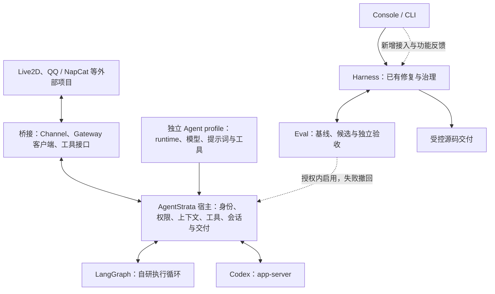
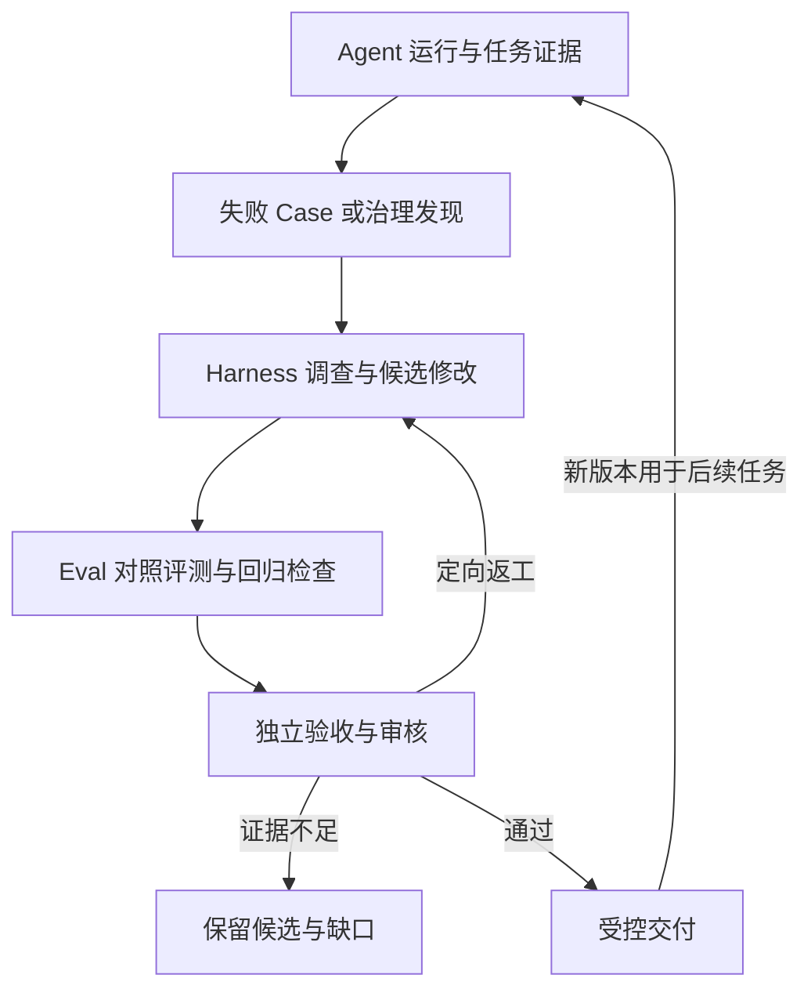

<div align="center">

# AgentStrata

### 自研 Agent、外部项目桥接与评测驱动的持续改进

**让 Agent 驱动外部项目，并用可核验的证据持续改进。**

目标流程：Agent 连接外部能力 → 运行与反馈 → Harness 开发 → Eval 验收 → 授权内启用

[](https://github.com/Ling-ye/AgentStrata/blob/main/LICENSE)
[](https://github.com/Ling-ye/AgentStrata/blob/main/pyproject.toml)
[](https://github.com/Ling-ye/AgentStrata/blob/main/docs/guides/deployment.md)

[实施状态](#实施状态与开发计划) · [框架总览](#框架总览) · [自我优化](#如何实现自我优化) · [Harness](#harness基于-langgraph-的修复与验收) · [Eval](#eval评测与证据体系) · [快速开始](#快速开始) · [产品界面](#产品界面) · [文档](https://github.com/Ling-ye/AgentStrata/blob/main/docs/README.md)

</div>

AgentStrata 提供自研 Agent 系统、外部项目桥接能力，以及基于 Harness 与 Eval 的持续改进机制。Agent 通过 LangGraph 或 Codex 执行，连接 Live2D、QQ / NapCat 等可由 Agent 驱动的项目。用户通过需求与反馈发起改进，目标是由 Harness 完成调查、开发、对照评测和独立验收，再在授权范围内启用。

当前已有应用与 Agent 配置分离、双 runtime、QQ 和 Live2D 接入、独立 Eval，以及故障修复和代码治理。Harness 编排直接使用 LangGraph，项目定义身份权限、候选、评测证据和独立验收。新增能力的完整改进流程与实例自动启用仍按阶段开发；fork、构建和部署在具体接入需要时使用。

## 实施状态与开发计划

| 状态 | 内容 | 使用或开发入口 |
| --- | --- | --- |
| 已有基础 | LangGraph、Codex 执行路由，独立 Eval，Harness 修复、治理与受控源码交付 | [架构总览](https://github.com/Ling-ye/AgentStrata/blob/main/docs/reference/architecture.md)、[Harness 指南](https://github.com/Ling-ye/AgentStrata/blob/main/docs/guides/harness.md) |
| 已有基础 | QQ 渠道和 Live2D 独立客户端、插件安装与任务观测 | [QQ](https://github.com/Ling-ye/AgentStrata/blob/main/docs/guides/qq.md)、[Live2D](https://github.com/Ling-ye/AgentStrata/blob/main/docs/guides/live2d.md) |
| 已实现 M1 | 应用文件引用独立 Agent profile；新建应用拥有独立模型用途；提供显式配置迁移，复用既有 runtime 与实例状态管理 | [配置归属](https://github.com/Ling-ye/AgentStrata/blob/main/docs/reference/configuration.md#配置归属与文件引用)、[迁移步骤](https://github.com/Ling-ye/AgentStrata/blob/main/docs/guides/instances.md#迁移内联-agent-配置) |
| 已实现 M1.1 | 双 runtime 收敛、自有子 Agent 使用 LangGraph、Native 配置退役 | [执行契约](https://github.com/Ling-ye/AgentStrata/blob/main/docs/reference/agent.md#一条执行契约) |
| 后续实现 | M2—M7：桥接基线、Agent 与桥接评测、需求改进、版本启用撤回、工作台及真实闭环 | [分阶段开发](specs/application-harness-framework/spec.md#分阶段开发) |

主计划的 `accepted` 表示设计可进入实施，不代表整套能力已经完成。当前命令与操作条件以快速开始和指南为准；阶段验收通过后，再更新对应能力状态。

代表性使用场景：

- **运行已有应用。** 使用 QQ 机器人或 Live2D 客户端，配置模型、工具与运行环境，查看执行与评测证据。
- **连接外部能力（规划）。** 提供接口或仓库线索、接入目标和 Agent 配置，优先沿现有协议开发桥接；需要改动上游时才管理源码与构建。
- **按反馈改进（规划）。** 在 Console 或 CLI 提交新增功能或问题反馈，改进自有 Agent、提示词、上下文、工具、Skill 或桥接；验收通过后在预授权范围内启用新版本。

## 框架总览

实线展示已有运行关系与修复验证，虚线展示后续扩展。完整设计见[主计划](specs/application-harness-framework/spec.md#职责与数据流)。



实际消息处理遵循 Channel → Gateway → Application → Agent 四层职责，Harness 与 Eval 在链外协作。实例通过 Agent profile 选择一个 runtime，记忆和工作区仍由各实例管理。LangGraph 路径可优化自有执行循环；Codex 路径可优化宿主提供的提示词、工具、上下文与桥接，其原生线程和压缩由 Codex 管理。

## 如何实现自我优化

当前自我优化发生在代码、获准提示词、工具实现、执行流程及受限的 Skill 经验层面。每次改进先形成候选，再由冻结的验证条件与独立审核判断是否接受。下面是已有修复与治理流程；面向 Agent 与桥接的需求改进与自动启用按主计划扩展。



| 改进方式 | 如何开始 | 如何判断有效 |
| --- | --- | --- |
| 故障自修复 | 选择符合条件的失败 Case 或机器人任务 | 确认失败基线，验证原目标改善，并保护已有通过项 |
| 自身代码治理 | 按现行设计与黄金原则调查代码熵，可包含 Harness 自身 | 证明实际改善与行为保持，通过仓库检查及独立审核 |
| 经验沉淀 | Harness 相关治理项合入后，判断是否存在可复用方法 | 受限 Skill 学习任务经审核交付，由后续任务读取新版本 |

操作者选择任务来源与预算，也可显式启用定时代码熵治理。当前任务始终使用冻结宿主、规则与评分；候选不能改变本次验收标准。新版本在后续任务生效，机器人实例更新仍按部署流程进行。这里的优化不涉及模型权重训练，执行状态、环境或证据无法确认时保留缺口。

## Harness：基于 LangGraph 的修复与验收

Harness 使用 LangGraph 的图、子图、检查点和中断恢复组织调查、计划、编码、测试、返工与验收。项目实现来源冻结、角色权限、候选工作区、失败分类、预算、外部操作回执与接受条件。新架构将在这一基础上增加应用接入和需求驱动的改进入口，共用开发与验收流程。

- **有依据地改。** 从失败运行、人工线索或治理发现形成明确目标，在隔离工作区生成候选。
- **编码与验收分权。** Coding 只写获准产品文件，Test 只写验证草案，Review 独立审查；既有测试、评分与当前宿主保持冻结。
- **按具体失败返工。** 产品、测试、评分、环境和材料问题分别记录，明确错误返回相关角色，预算和无进展规则约束循环。
- **精确绑定结果。** 只有目标、保护集、仓库回归和所需独立确认满足要求，才签发绑定候选与证据的验收回执。
- **可恢复、可追查。** 图检查点与外部操作回执分别核对，已有确认结果可复用，执行终态未知时先对账；角色产物和命令日志按需查看。

修复验收、PR 交付和部署分别记录。完整机制见 [Harness 契约](https://github.com/Ling-ye/AgentStrata/blob/main/docs/reference/harness.md)，操作见 [Harness 指南](https://github.com/Ling-ye/AgentStrata/blob/main/docs/guides/harness.md)。

## Eval：评测与证据体系

Eval 为改动提供独立的判断依据。项目自行组织 Case、Target、Trial、隔离执行、服务生命周期、结果持久化与可比条件；具体评分遵循各基准的原生规则和题目声明的指标。

| 能力 | 对开发者的价值 |
| --- | --- |
| 冻结题目、执行对象、评分与环境条件 | 对照基线和候选，区分改善、已有失败和新增回归 |
| 保存回答、工具轨迹、真实产物与逐项评分 | 判断失败发生在哪一步，为修复和瓶颈分析提供依据 |
| 独立保存原生评分与附加语义评分 | 保留原目标，避免附评分数覆盖基准成绩 |
| 核对题集、模型、评分与环境的可比性 | 避免把执行条件变化直接解释为能力进步 |

项目实现 **IFEval、BFCL、GAIA 等公开 benchmark 的适配、执行与评分流程**，同时维护自建 Agent 任务与红队用例。环境或数据未准备时显示阻断原因。符合来源条件的失败实例可以进入 Harness，原题与评分继续由 Eval 管理。

详见 [Evaluation 机制](https://github.com/Ling-ye/AgentStrata/blob/main/docs/reference/evaluation.md)、[评测指南](https://github.com/Ling-ye/AgentStrata/blob/main/docs/guides/evaluation.md)与[用例指南](https://github.com/Ling-ye/AgentStrata/blob/main/docs/guides/evaluation-cases.md)。

## 项目模块与执行路由

消息运行遵循项目定义的 **Channel → Gateway → Application → Agent** 四层架构。身份、准入、资源、会话、模型、工具与用户交付各有职责；Harness、Eval 和 Console 位于消息运行链之外。

| 项目模块 | 负责什么 |
| --- | --- |
| Agent 运行框架 | 四层职责、身份权限、会话、实例配置、执行结果与交付事实 |
| 模型与执行路由 | 按配置选择执行方式与模型，共享项目定义的任务、工具、权限和结果契约 |
| 工具、上下文与记忆 | 在获准范围内提供能力、准备材料并保存上下文 |
| Harness | 基于 LangGraph 的修复与治理编排，项目定义角色权限、候选隔离、操作回执和独立验收 |
| Eval | 评测对象、任务执行、条件绑定、评分组织、证据、比较与服务生命周期 |
| Console / CLI | 任务控制、观测、候选与证据查看，以及交付状态查询 |

框架的执行方式与模型通过路由配置选择，各入口的支持范围以对应契约为准。具体路由见 [Agent 与执行 Runtime](https://github.com/Ling-ye/AgentStrata/blob/main/docs/reference/agent.md)，设计参考、当前实现依赖和源码入口见[架构总览](https://github.com/Ling-ye/AgentStrata/blob/main/docs/reference/architecture.md)。

## 快速开始

### 给人类：选择你的使用路径

在 Linux 或 WSL2 准备源码开发环境：

```bash
git clone https://github.com/Ling-ye/AgentStrata.git
cd AgentStrata
uv sync --frozen --extra agent --extra acp --extra dev --extra weixin
uv run agentstrata --help
```

| 想做什么 | 从哪里开始 |
| --- | --- |
| 测量 Agent 表现、比较改动 | 按 [Evaluation 指南](https://github.com/Ling-ye/AgentStrata/blob/main/docs/guides/evaluation.md)准备模型、数据与评测环境 |
| 修复失败或改进框架自身 | 按 [Harness 指南](https://github.com/Ling-ye/AgentStrata/blob/main/docs/guides/harness.md)配置专用 worker、评测服务和交付，再选择失败来源或代码熵任务 |
| 运行 QQ 机器人应用 | 按[首次部署](https://github.com/Ling-ye/AgentStrata/blob/main/docs/guides/deployment.md)使用 `bash deploy/wsl/quickstart.sh`，可先加 `--dry-run` 预览 |
| 使用已有 Live2D 客户端或角色生成器 | 按 [Live2D 指南](https://github.com/Ling-ye/AgentStrata/blob/main/docs/guides/live2d.md)准备模型连接并安装对应插件 |
| 修改代码与扩展能力 | 从[开发指南](https://github.com/Ling-ye/AgentStrata/blob/main/docs/guides/development.md)进入对应领域和检查范围 |

正式 Harness 入口冻结远端 main，通过验收后由宿主创建正式 PR 并启用 squash 自动合并；开始前须配置相应交付权限。模型、平台账号与第三方服务由使用者配置。上述命令准备源码环境，各运行组件的配置按对应指南完成。

### 给 AI：按任务逐层读取

可以将以下说明交给仓库中的 AI 协作者：

> 先读取根目录 AGENTS.md，确认 AgentStrata 的定位、协作边界与任务路由。根据我的当前目标读取相关领域章节，沿源码入口核对实现与测试；开发新接入框架时先确认主计划中的本阶段范围，涉及架构、公共契约、部署或迁移时再展开对应规格。说明依据、改动与实际验证。

[AGENTS.md](https://github.com/Ling-ye/AgentStrata/blob/main/AGENTS.md)是 AI 协作入口，[文档导航](https://github.com/Ling-ye/AgentStrata/blob/main/docs/README.md)面向使用与开发任务。两条路径共用领域正文，完整规则只维护一处。

## 产品界面

以下截图由当前 Console 前端配合**示例数据**渲染，展示界面布局与信息组织，不代表真实部署、模型成绩或线上修复结果；点击图片可查看原图。

**Harness：冻结来源、修复步骤与验收依据**

[](https://github.com/Ling-ye/AgentStrata/blob/main/docs/assets/readme/harness.png)

**Evaluation：题目、执行对象与评分计划**

[](https://github.com/Ling-ye/AgentStrata/blob/main/docs/assets/readme/evaluation.png)

<details>
<summary>查看任务轨迹、代码熵治理与机器人实例</summary>

**任务运行：四层轨迹、模型输入与工具结果**

[](https://github.com/Ling-ye/AgentStrata/blob/main/docs/assets/readme/task-runtime.png)

**代码熵治理：问题调查与待判断证据**

[](https://github.com/Ling-ye/AgentStrata/blob/main/docs/assets/readme/code-health.png)

**QQ 机器人实例：Gateway 运行状态**

[](https://github.com/Ling-ye/AgentStrata/blob/main/docs/assets/readme/bots.png)

</details>

## 开源价值与相关项目

项目开放运行、Harness、Eval、修复规则与验收源码，开发者可以自行运行、审查和修改这套改进过程。基础能力优先复用成熟项目，应用接入与独立验收保留必要实现；模型、计算资源与第三方服务仍需自行配置。

| 项目 | 参考或复用内容 | 当前采用方式 |
| --- | --- | --- |
| [LangGraph](https://github.com/langchain-ai/langgraph) | 图执行、子图、持久化、中断与恢复 | 已是 Harness 及 LangGraph runtime 的实际依赖，后续继续直接复用公共 API |
| [DeepEval](https://github.com/confident-ai/deepeval) 与官方评分器 | 具体指标和基准评分 | 已在 Eval 生命周期内使用，评测对象、条件与证据由项目管理 |
| [OpenClaw](https://github.com/openclaw/openclaw/tree/672c4357a65aa960e1fcf2be3fecf47d56c25f37) | 宿主与执行循环分工、Codex app-server 工具桥接 | 设计参考；继续复用本项目 RuntimeAdapter，不引入上游运行体系 |
| [Deep Agents / better-harness](https://github.com/langchain-ai/deepagents/tree/f26eb54c9b9f66d2ea7edbb9748413d58744534d/examples/better-harness) | Agent 执行能力组织、基线与候选改进流程 | 设计参考，未作为新框架接入；独立验收和隔离边界仍由项目保持 |
| [GEPA](https://gepa-ai.github.io/gepa/api/optimize_anything/optimize_anything/) / [Harbor](https://docs.harborframework.com/agents/custom-agents) | 候选搜索、外部 Agent 与评测环境适配 | 后续候选方案，首版不增加强依赖 |

具体源码入口、固定 revision、版本差异和采用理由见[主计划的复用清单](specs/application-harness-framework/spec.md#开源复用与版本依据)。设计参考不代表已经集成，也不代表性能或修复成功率排名。

各执行入口的前置条件与支持范围见 [Agent 路由说明](https://github.com/Ling-ye/AgentStrata/blob/main/docs/reference/agent.md)和 [Harness 操作指南](https://github.com/Ling-ye/AgentStrata/blob/main/docs/guides/harness.md)。通用仓库自动接入与实例自动启用尚未提供；模型权重训练不在本计划中。产品回放可使用冻结外部夹具，模拟回执不证明真实 QQ 送达。

## 参与开发

按阶段建设新框架时，从[主计划开发阶段（含 M1.1）](specs/application-harness-framework/spec.md#分阶段开发)确认前置条件、交付物和验收标准，再进入[贡献指南](https://github.com/Ling-ye/AgentStrata/blob/main/CONTRIBUTING.md)与[文档导航](https://github.com/Ling-ye/AgentStrata/blob/main/docs/README.md)。也欢迎继续改进已有 Harness、Eval、运行、工具和 Console。Python namespace 仍为 `chatcopilot`，依赖与支持范围以 [pyproject.toml](https://github.com/Ling-ye/AgentStrata/blob/main/pyproject.toml) 为准。

[安全](https://github.com/Ling-ye/AgentStrata/blob/main/SECURITY.md) · [支持](https://github.com/Ling-ye/AgentStrata/blob/main/SUPPORT.md) · [行为准则](https://github.com/Ling-ye/AgentStrata/blob/main/CODE_OF_CONDUCT.md) · [变更记录](https://github.com/Ling-ye/AgentStrata/blob/main/CHANGELOG.md) · [AGPL-3.0-only 许可](https://github.com/Ling-ye/AgentStrata/blob/main/LICENSE)

## 版权、许可与源码

Copyright (C) 2026 Lingye · 联系：616202172@qq.com。项目自有代码和文档采用
[AGPL-3.0-only](https://github.com/Ling-ye/AgentStrata/blob/main/LICENSE)，完整适用范围见 [COPYRIGHT](https://github.com/Ling-ye/AgentStrata/blob/main/COPYRIGHT)。允许依许可商业使用、
修改和再分发；本程序不提供担保。第三方材料按[第三方声明](https://github.com/Ling-ye/AgentStrata/blob/main/THIRD_PARTY_NOTICES.md)保留原许可。
历史版本已授予的 MIT 权利不受本次迁移影响。

[项目源码](https://github.com/Ling-ye/AgentStrata)可公开获取；Console「许可与源码」、
`agentstrata source` 和机器人 `/source` 提供同一入口。部署修改版时，运营者须将
`CHATCOPILOT_SOURCE_URL` 设置为实际运行版本的完整源码获取地址，不能只指向上游最新分支。
源码交付要求与选配集成边界见[公开与发布契约](https://github.com/Ling-ye/AgentStrata/blob/main/docs/reference/publication.md#许可与对应源码)。
