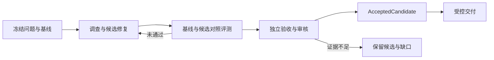
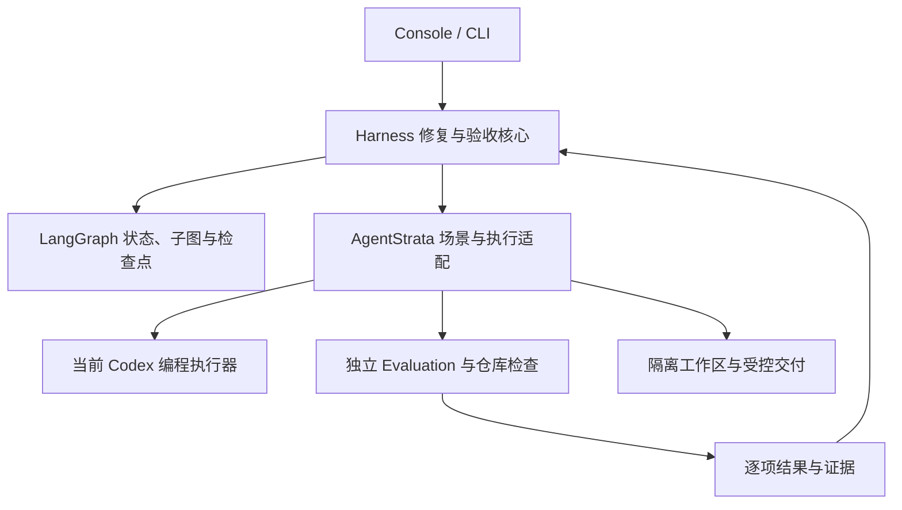

# AgentStrata

**基于 LangGraph 的开源 Agent 自修复与评测框架，让改进过程有证据、有验收、有边界。**

Agent 出错以后，开发者需要知道问题发生在哪里，也需要判断提示词、上下文、工具或执行流程的改动是否有效。AgentStrata 将失败运行、候选修复和独立验收组织成可复核的流程，帮助开发者改进自己的 Agent。

项目采用 MIT 许可，开放修复、评测与验收机制的源码。QQ 机器人是当前落地场景；Console 提供任务控制、执行观测和证据查看，Evaluation 与 Harness 在消息运行链之外独立运行。

## Harness：从失败证据到可验收的修复

选定一个问题后，宿主冻结来源、源码、目标与规则，在隔离工作区中生成候选。基线与候选接受同一验证定义检查，只有目标、保护集和独立审核全部满足，才生成绑定候选与证据的 `AcceptedCandidate`。



修复流程按需使用 Plan、Coding、Test、Review 与 Main 角色。Coding 只写获准产品文件，Test 只写验证草案；现有测试、评分、权限和正在运行的 Harness 控制程序保持冻结。评分、环境与材料故障单独记录，不能作为产品缺陷反复改代码。

过程中的输入、角色产物、验证结果和命令日志都可以复查。恢复时分别核对图检查点与外部执行回执：已确认的结果可以复用，执行终态未知时先对账。修复验收、PR 交付与机器人部署分别记录，交付不会自动部署运行实例。

详见 [Harness 设计](https://github.com/Ling-ye/AgentStrata/blob/main/docs/reference/harness.md)、[操作指南](https://github.com/Ling-ye/AgentStrata/blob/main/docs/guides/harness.md)与[交付契约](https://github.com/Ling-ye/AgentStrata/blob/main/docs/reference/delivery.md)。

## 核心、执行适配与 Eval 各自负责什么



`engine` 负责修复顺序、返工和最终接受；`integrations` 解释问题来源、准备角色材料，并提供产品验证和代码熵治理规则。具体执行器和环境由宿主注入。图状态保存执行位置与产物引用，模型正文、日志和补丁按需读取。

当前支持三类问题来源，各自保留原目标和验收要求：

| 来源 | 冻结内容 | 验收依据 |
| --- | --- | --- |
| 可修复的测评 Case | 原题、评分、失败实例与执行条件 | 有效失败基线、原目标与保护集 |
| 机器人任务 | 原始观测、人工线索与预期行为 | 沿真实产品装配回放，并核对执行与交付证据 |
| 代码熵治理 | 远端 main、现行 SDD、黄金原则与选定问题 | 实际改善、行为保持、仓库检查与独立审核 |

代码熵治理也可以在受控范围内改进 Harness 本身。当前任务仍由冻结宿主验收，候选不能修改自己的检查标准；通过验收与交付的改动在后续版本生效。相关治理项完成后，可以形成受独立审核约束的 Skill 学习任务。[代码熵治理](https://github.com/Ling-ye/AgentStrata/blob/main/docs/reference/code-health.md)

## Evaluation：把改动效果变成可比较的证据

项目实现 **IFEval、BFCL、GAIA 等公开 benchmark 的适配、执行与评分流程**，并维护自建 Agent 任务和红队用例。模型回答、工具轨迹、真实产物和语义评分分别记录；原生评分不会被附加语义分覆盖。

比较结果时核对题目、执行对象、评分与环境条件，区分改善、回归和证据不足。数据或环境未准备时显示阻断原因，不把未运行或评分异常计为通过。失败 Case 进入 Harness 前，还需要满足修复来源条件。[测评设计](https://github.com/Ling-ye/AgentStrata/blob/main/docs/reference/evaluation.md)

## 开源价值与相关项目

AgentStrata 面向希望自行运行、审查和修改修复流程的开发者。MIT 许可允许按项目需要调整执行适配、保护集和验收规则；模型、计算资源和第三方服务仍需自行配置。

| 项目 | 主要职责 | 开放方式与本项目的关系 |
| --- | --- | --- |
| LangGraph | 状态化编排、持久化、子图与中断恢复 | [MIT 开源](https://github.com/langchain-ai/langgraph/blob/main/LICENSE)，是 AgentStrata 使用的编排基础 |
| LangSmith / Engine | 观测、评测、问题诊断与修复工作流 | SDK 有开源实现；平台和 Engine 按商业产品提供，自托管 Engine 需要相应许可 |
| AgentStrata | 冻结问题、生成修复候选、对照验证、独立验收与受控交付 | [MIT 开源](https://github.com/Ling-ye/AgentStrata/blob/main/LICENSE)，修复和验收源码可自行运行、检查与修改 |

授权与产品边界于 2026-10-17 核对，依据 [LangSmith SDK](https://github.com/langchain-ai/langsmith-sdk) 与 [Engine 自托管说明](https://docs.langchain.com/langsmith/engine-self-hosted)。这张表比较职责和开放方式，不代表修复成功率或性能评测。

当前正式编程执行器仍依赖 Codex worker。修复核心与项目适配已经分开，但不等于已经支持任意外部项目或所有 runtime；完整自修复也尚未由用户自训练的本地模型替代。

## 当前应用与运行边界

QQ 消息按 **Channel → Gateway → Application → Agent** 四层处理，分别承担平台事件与投递、可信身份与准入、会话和资源准备、模型与工具执行。BotSpec 声明实例能力，Console 提供控制与观测；Harness 和 Eval 不构成第五个串行消息层。

机器人故障验收沿真实产品装配回放目标链路，外部 Provider 和资源可以使用冻结夹具。模拟回执不代表真实 QQ 送达，界面也不会补造未采集的执行正文。详见 [任务观测](https://github.com/Ling-ye/AgentStrata/blob/main/docs/reference/observability.md)和[架构总览](https://github.com/Ling-ye/AgentStrata/blob/main/docs/reference/architecture.md)。

## 产品界面

以下五张图由当前 Console 前端配合**示例数据**渲染。图中的状态、题目和修复记录用于展示界面，不代表真实部署、模型成绩或线上修复结果；点击图片可查看原图。

**任务运行 · 四层轨迹与 Agent 执行详情**

示例任务同时展示 Channel、Gateway、Application、Agent 四层阶段，以及所选模型调用的输入、工具结果和公开响应。

[](https://github.com/Ling-ye/AgentStrata/blob/main/docs/assets/readme/task-runtime.png)

**Harness · 冻结来源、修复步骤与验收依据**

[](https://github.com/Ling-ye/AgentStrata/blob/main/docs/assets/readme/harness.png)

**代码熵治理 · 问题调查与待判断证据**

[](https://github.com/Ling-ye/AgentStrata/blob/main/docs/assets/readme/code-health.png)

**测评中心 · 题目、执行对象与评分计划**

[](https://github.com/Ling-ye/AgentStrata/blob/main/docs/assets/readme/evaluation.png)

**QQ 机器人实例 · Gateway 运行状态**

[](https://github.com/Ling-ye/AgentStrata/blob/main/docs/assets/readme/bots.png)

## 开始使用

评测与修复入口见 [Evaluation 操作指南](https://github.com/Ling-ye/AgentStrata/blob/main/docs/guides/evaluation.md)和 [Harness 操作指南](https://github.com/Ling-ye/AgentStrata/blob/main/docs/guides/harness.md)。先配置模型、评测服务与 worker，再选择具体 Case 或机器人任务；代码熵治理使用同一套验收与交付机制。

在 Linux 或 WSL2 源码仓中使用 QQ 机器人终端向导：

```bash
git clone https://github.com/Ling-ye/AgentStrata.git
cd AgentStrata
bash deploy/wsl/quickstart.sh
```

向导需要模型 API 配置和 QQ 登录；可先运行 `bash deploy/wsl/quickstart.sh --dry-run` 查看变更。前置条件、人工登录与恢复步骤见 [首次部署](https://github.com/Ling-ye/AgentStrata/blob/main/docs/guides/deployment.md)。

如果要阅读或修改框架源码：

```bash
uv sync --frozen --extra agent --extra acp --extra dev
uv run agentstrata --help
```

开发与检查方式见 [开发指南](https://github.com/Ling-ye/AgentStrata/blob/main/docs/guides/development.md)，各领域入口见 [文档任务地图](https://github.com/Ling-ye/AgentStrata/blob/main/docs/README.md)。Python namespace 仍为 `chatcopilot`，环境变量使用 `CHATCOPILOT_*`；版本与依赖以 [pyproject.toml](https://github.com/Ling-ye/AgentStrata/blob/main/pyproject.toml) 为准。项目提供源码与自托管工具；模型、平台账号和第三方凭据需自行配置。

[贡献](https://github.com/Ling-ye/AgentStrata/blob/main/CONTRIBUTING.md) · [安全](https://github.com/Ling-ye/AgentStrata/blob/main/SECURITY.md) · [支持](https://github.com/Ling-ye/AgentStrata/blob/main/SUPPORT.md) · [行为准则](https://github.com/Ling-ye/AgentStrata/blob/main/CODE_OF_CONDUCT.md) · [变更记录](https://github.com/Ling-ye/AgentStrata/blob/main/CHANGELOG.md) · [MIT 许可](https://github.com/Ling-ye/AgentStrata/blob/main/LICENSE)

## AI 协作者阅读入口

先读 [AGENTS.md](https://github.com/Ling-ye/AgentStrata/blob/main/AGENTS.md) 掌握协作、权限与架构边界；再从 [文档任务地图](https://github.com/Ling-ye/AgentStrata/blob/main/docs/README.md)进入当前任务的领域正文。需要修改架构或公开契约时，沿领域链接继续读对应 [规格](https://github.com/Ling-ye/AgentStrata/blob/main/specs/README.md)和源码；只加载与任务相关的层级，不批量展开全部文档。
