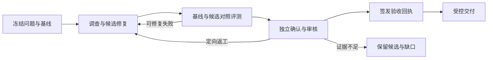

# AgentStrata

**基于 LangGraph 的开源 Agent 自修复与评测框架，让改进过程有证据、有验收、有边界。**

Agent 出错后，开发者需要定位问题，也需要判断提示词、上下文、工具或执行流程的改动是否有效。AgentStrata 将失败运行、候选修复和对照评测串起来，保留每一步的输入、执行结果和验收依据，帮助开发者改进自己的 Agent。

项目面向希望自行运行、审查和修改修复流程的开发者。Harness 与 Evaluation 是核心能力，Console 提供控制与证据查看，QQ 机器人是当前应用场景。

[开始使用](#开始使用) · [Harness 操作指南](https://github.com/Ling-ye/AgentStrata/blob/main/docs/guides/harness.md) · [修复与验收机制](https://github.com/Ling-ye/AgentStrata/blob/main/docs/reference/harness.md) · [文档导航](https://github.com/Ling-ye/AgentStrata/blob/main/docs/README.md)

## 改动是否有效，由什么判断

| 核心能力 | 具体做法 | 对开发者的价值 |
| --- | --- | --- |
| 对照评测 | 冻结问题、源码、评分和执行条件，用同一验证定义检查基线与候选 | 区分目标改善、已有失败和新增回归 |
| 独立验收 | 编码、测试草案和审核分权；候选不能修改本次宿主、既有评分与验收规则 | 模型自评或一次命令成功不足以宣布修复 |
| 过程可追溯 | 保存角色产物、逐项检查、失败证据和命令日志；恢复时核对检查点与外部执行回执 | 可以追查失败与返工原因，并依据阶段记录分析执行瓶颈 |
| MIT 开放实现 | 开放修复核心、项目适配、评测与验收源码 | 可以自行运行、审查和修改规则及执行适配 |

## 从问题到可验收的候选



首轮由 Plan 调查问题，Coding 只写获准产品文件，Test 只写验证草案，Review 独立审查；Main 按需处理根因变化与分歧。只有目标、保护集、仓库回归和所需独立确认满足要求，才签发绑定精确候选与证据的 `AcceptedCandidate`。评分、环境和材料故障单独记录，执行终态未知时先对账。

| 组成 | 职责 |
| --- | --- |
| LangGraph | 管理图执行位置、状态、子图与中断恢复 |
| Harness | 决定修复顺序、定向返工与最终接受，保存执行回执和证据 |
| 项目适配与执行器 | 解释问题来源，准备角色材料、隔离工作区与产品验证；当前编程执行器使用 Codex |
| Evaluation | 独立执行评测并保存评分、逐项结果和证据 |
| Console / CLI | 发起、查询、取消和恢复任务，查看候选与交付状态 |

修复核心与 AgentStrata 集成分开，执行依赖由宿主注入。修复验收、PR 交付和机器人部署分别记录，通过验收不会自动部署运行实例。详见 [Harness 契约](https://github.com/Ling-ye/AgentStrata/blob/main/docs/reference/harness.md)与[交付契约](https://github.com/Ling-ye/AgentStrata/blob/main/docs/reference/delivery.md)。

## 当前可以用来做什么

| 场景 | 输入 | 判断依据 |
| --- | --- | --- |
| 修复测评失败 | 符合修复条件的 Case 实例、原题与失败证据 | 有效失败基线、原目标改善与保护集保持 |
| 调查机器人故障 | 任务观测、可选人工线索与预期行为 | 沿产品装配回放原目标，核对模型、工具与交付证据 |
| 代码熵治理 | 冻结主干、现行设计与黄金原则 | 实际改善、行为保持、仓库检查与独立审核 |

治理范围也包含 Harness 自身。当前任务始终由冻结宿主验收，候选不能改变自己的检查标准；通过验收与交付的改动在后续版本生效。相关治理项合入后，可通过受限的 Skill 学习任务沉淀方法。详见[代码熵治理](https://github.com/Ling-ye/AgentStrata/blob/main/docs/reference/code-health.md)。

Evaluation 实现 **IFEval、BFCL、GAIA 等公开 benchmark 的适配、执行与评分流程**，同时维护自建 Agent 任务与红队用例。原生评分与附加语义评分分别记录；结果按题目、模型、评分和环境条件判断是否可比。数据或环境未准备时显示阻断原因。并非所有 benchmark 结果都能直接进入自动修复，来源条件见 [Harness 指南](https://github.com/Ling-ye/AgentStrata/blob/main/docs/guides/harness.md)。

## 开始使用

### 评测与修复

1. 按 [Evaluation 指南](https://github.com/Ling-ye/AgentStrata/blob/main/docs/guides/evaluation.md)准备数据、模型方案和评测服务，执行目标任务并检查结果。
2. 按 [Harness 指南](https://github.com/Ling-ye/AgentStrata/blob/main/docs/guides/harness.md)配置专用 Codex worker、隔离环境与 GitHub 交付，选择失败 Case、机器人任务或代码熵治理。
3. 在 Console 或 CLI 查看候选、对照结果与验收缺口，再分别跟踪交付状态。

正式修复入口冻结远端 main，使用模型生成并验证候选，通过后由宿主创建正式 PR 并启用 squash 自动合并。开始前需完成交付配置；模型和第三方服务费用由使用者承担。

### 阅读或修改源码

```bash
git clone https://github.com/Ling-ye/AgentStrata.git
cd AgentStrata
uv sync --frozen --extra agent --extra acp --extra dev --extra weixin
uv run agentstrata --help
```

以上准备源码开发环境；Evaluation、Console 和 worker 的运行配置分别遵循对应指南。检查范围见[开发指南](https://github.com/Ling-ye/AgentStrata/blob/main/docs/guides/development.md)。Python namespace 仍为 `chatcopilot`；配置入口见[配置正文](https://github.com/Ling-ye/AgentStrata/blob/main/docs/reference/configuration.md)，版本与依赖以 [pyproject.toml](https://github.com/Ling-ye/AgentStrata/blob/main/pyproject.toml) 为准。

### 部署 QQ 机器人

Linux 或 WSL2 源码仓库提供终端向导：

```bash
bash deploy/wsl/quickstart.sh --dry-run
bash deploy/wsl/quickstart.sh
```

向导需要模型配置与 QQ 登录，前置条件、人工登录和恢复步骤见[首次部署](https://github.com/Ling-ye/AgentStrata/blob/main/docs/guides/deployment.md)。消息仍按 Channel → Gateway → Application → Agent 四层处理；Harness 与 Eval 在消息链之外独立运行。详见[架构总览](https://github.com/Ling-ye/AgentStrata/blob/main/docs/reference/architecture.md)。

## 开源价值、相关项目与当前边界

| 项目 | 主要职责 | 开放方式与本项目的关系 |
| --- | --- | --- |
| LangGraph | 状态化编排、持久化、子图与中断恢复 | [MIT 开源](https://github.com/langchain-ai/langgraph/blob/main/LICENSE)，是 AgentStrata 使用的编排基础 |
| LangSmith / Engine | 观测、评测、问题调查与修复工作流 | [SDK 为 MIT 开源](https://github.com/langchain-ai/langsmith-sdk/blob/main/LICENSE)；Engine 提供商业自托管，需要包含 Engine 权益的许可，见[官方说明](https://docs.langchain.com/langsmith/engine-self-hosted) |
| AgentStrata | 冻结问题、生成候选、对照评测、独立验收与受控交付 | [MIT 开源](https://github.com/Ling-ye/AgentStrata/blob/main/LICENSE)，修复和验收实现可自行运行、审查与修改 |

授权与产品边界于 2026-10-19 核对。对照说明职责与开放方式，不代表修复成功率或性能排名。AgentStrata 的开源价值在于修复与验收实现可修改；自托管仍需配置模型、计算资源和第三方服务。

当前正式编程执行器依赖 Codex worker；核心与项目适配已分开，但通用外部项目接入和自训练本地模型执行完整修复链尚未提供。阶段记录与命令日志可帮助定位瓶颈，不等于自动性能诊断。产品回放中的外部 Provider 与资源可以采用冻结夹具，模拟回执不证明真实 QQ 送达。

## 产品界面

以下截图由当前 Console 前端配合**示例数据**渲染，展示界面布局与信息组织，不代表真实部署、模型成绩或线上修复结果；点击图片可查看原图。

**Harness：冻结来源、修复步骤与验收依据**

[](https://github.com/Ling-ye/AgentStrata/blob/main/docs/assets/readme/harness.png)

**Evaluation：题目、执行对象与评分计划**

[](https://github.com/Ling-ye/AgentStrata/blob/main/docs/assets/readme/evaluation.png)

<details>
<summary>查看任务轨迹、代码熵治理与机器人实例</summary>

**任务运行：四层轨迹、模型输入与工具结果**

[](https://github.com/Ling-ye/AgentStrata/blob/main/docs/assets/readme/task-runtime.png)

**代码熵治理：问题调查与待判断证据**

[](https://github.com/Ling-ye/AgentStrata/blob/main/docs/assets/readme/code-health.png)

**QQ 机器人实例：Gateway 运行状态**

[](https://github.com/Ling-ye/AgentStrata/blob/main/docs/assets/readme/bots.png)

</details>

## 参与开发

从[贡献指南](https://github.com/Ling-ye/AgentStrata/blob/main/CONTRIBUTING.md)与[文档任务地图](https://github.com/Ling-ye/AgentStrata/blob/main/docs/README.md)进入具体领域。AI 协作者先读 [AGENTS.md](https://github.com/Ling-ye/AgentStrata/blob/main/AGENTS.md)，再按任务读取相关正文、规格与源码。

[安全](https://github.com/Ling-ye/AgentStrata/blob/main/SECURITY.md) · [支持](https://github.com/Ling-ye/AgentStrata/blob/main/SUPPORT.md) · [行为准则](https://github.com/Ling-ye/AgentStrata/blob/main/CODE_OF_CONDUCT.md) · [变更记录](https://github.com/Ling-ye/AgentStrata/blob/main/CHANGELOG.md) · [MIT 许可](https://github.com/Ling-ye/AgentStrata/blob/main/LICENSE)
