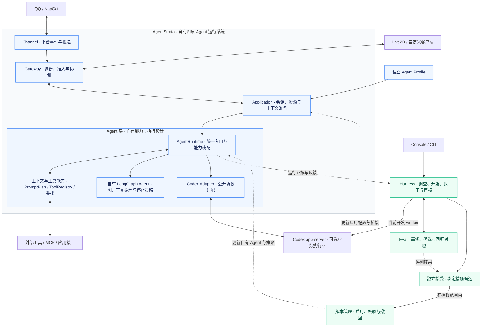

<div align="center">

# AgentStrata

### 面向外部应用的可定制 Agent 运行系统

**自有四层架构 · 可优化的 LangGraph Agent · 外部能力接入 · Harness 与 Eval**

[](https://github.com/Ling-ye/AgentStrata/blob/main/LICENSE)
[](https://github.com/Ling-ye/AgentStrata/blob/main/pyproject.toml)
[](https://github.com/Ling-ye/AgentStrata/blob/main/docs/guides/deployment.md)

[项目特色](#项目特色) · [应用场景](#应用场景) · [框架总览](#框架总览) · [改进闭环](#改进闭环) · [产品界面](#产品界面) · [快速开始](#快速开始) · [参与开发](#参与开发) · [English contribution guide](docs/guides/contributing-en.md)

</div>

AgentStrata 是一个面向外部应用的可定制 Agent 运行系统。它以自有四层架构承载应用接入、会话、上下文和 Agent 能力。项目自行实现能力装配、上下文组织、工具使用，以及基于 LangGraph 的执行循环与协作策略；**这些自有实现都是 Harness 的主要优化对象**。

你可以把 Agent 连接到 Live2D、QQ / NapCat，或其他提供 API、工具接口和消息渠道的项目，为应用配置独立的模型、人格、工具与记忆。Harness 根据需求开发适配、能力模块和运行策略，通过 Eval 与独立验收验证改进，再在授权范围内启用到指定实例。Codex 通过公开接口作为可选执行器接入，当前也是 Harness 的开发 worker。

**外部应用提出能力需求，自有 Agent 据此改进：每次改动有目标，效果有对照，运行版本有来源。**

| 想参与什么 | 从这里开始 |
| --- | --- |
| **接入自己的应用** | [交流接入目标](https://github.com/Ling-ye/AgentStrata/discussions/categories/q-a)，再选择 Channel、Gateway 客户端或工具接口 |
| **改进 Agent 能力** | [查看 Agent 任务](https://github.com/Ling-ye/AgentStrata/issues?q=is%3Aissue%20is%3Aopen%20label%3Aarea%3Aagent)，贡献工具发现、上下文或运行策略改进 |
| **贡献复现与评测** | [查看验证任务](https://github.com/Ling-ye/AgentStrata/issues?q=is%3Aissue%20is%3Aopen%20label%3Aarea%3Aeval)，提供场景、复现与可复核结果 |

第一次贡献可从[未认领的新手任务](https://github.com/Ling-ye/AgentStrata/issues?q=is%3Aissue%20is%3Aopen%20label%3A%22good%20first%20issue%22%20no%3Aassignee%20-linked%3Apr)和[首次 PR 步骤](CONTRIBUTING.md#第一次提交-pr)开始。欢迎中文或英文交流。

## 项目特色

| 特色 | 解决的问题 |
| --- | --- |
| **自有 Agent 能力可定制** | 能力装配、上下文、工具发现、LangGraph 循环与委托策略都有明确实现入口，可以按应用需求修改并评测。 |
| **Agent、应用与配置分离** | 同一套 Agent 能力可以服务不同应用；每个实例独立选择 runtime、模型、人格、工具、记忆和工作区。 |
| **接入现有项目** | 沿 Channel、Gateway 客户端、工具接口与 MCP 连接外部能力；优先复用现有协议，必要时编写薄适配器或维护受管源码。 |
| **需求驱动的 Harness** | 从新增能力、运行问题或代码治理目标出发，组织调查、计划、编码、测试、审核与返工。 |
| **独立的 Eval** | 冻结输入、评分和可比条件，核对 Agent 行为、工具结果、桥接回执与真实产物，保护已有能力。 |
| **候选与运行版本对应** | 接受回执绑定精确候选；启用后核对实际加载的代码和配置，失败撤回，执行中断先对账。 |
| **过程可以检查和接管** | Console 与 CLI 提供统一控制入口，保留任务轨迹、角色产物、模型与工具记录、评测结果和版本状态。 |

## 应用场景

**让 Live2D 成为 Agent 的交互界面。** 通过独立客户端完成文字、语音和角色呈现，Agent 负责理解任务、组织上下文与调用工具；表情和动作通过工具接口执行，并记录浏览器回执。角色生成器、角色库与 Windows 桌面壳作为可选组件配合使用。

**让 QQ / NapCat 成为 Agent 的消息渠道。** 沿 OneBot 接入消息收发，在宿主中统一处理身份、准入、会话与工具权限。Agent 的能力改进可以同时验证对 QQ 行为的影响，避免只改善一个入口，却破坏另一个入口。

**把自己的项目接入 Agent。** 提供接口说明或固定仓库版本、接入目标与可修改范围，由 Harness 调查已有能力，设计工具、插件或适配器。源码维护、构建和部署按具体需求展开，应用仍可以独立运行。

例如，你可以提出这样的需求：

> 让 Live2D 角色在任务完成后给出正确的动作反馈；任务失败时如实说明，避免误播完成动作。同时保留 QQ 原有的回复和权限行为。

围绕这个目标，框架组织候选修改和验收：核对 Agent 是否选用了合适的工具、动作是否真正执行、失败路径是否正确，以及 QQ 是否出现回归。评测、审核与启用结果分别保留，便于判断是否接受、继续返工或撤回版本。

## 框架总览

**Channel → Gateway → Application → Agent 四层共同构成产品主体。** Agent 层内的 `AgentRuntime` 是统一执行入口与共享能力装配；自有 LangGraph Agent 实现模型与工具循环。Harness 和 Eval 在消息链之外工作，生成并验证下一版 Agent、配置或桥接。



日常消息遵循 **Channel → Gateway → Application → Agent** 四层职责。Live2D 等独立客户端直接使用 Gateway；外部功能也可以作为工具被 Agent 调用。身份与权限由宿主确定，执行结果、服务方确认和用户可见交付分别记录。

### 自有 Agent 与可选执行器

项目统一定义身份、权限、上下文、工具、会话和结果契约。`agents.runtime` 保留 `langgraph` 和 `codex` 两种选择，一个正常回合由其中一种执行，模型连接与认证独立管理。LangGraph 路径是深度运行策略定制的主线。

| Runtime | 执行方式 | 主要改进范围 |
| --- | --- | --- |
| **LangGraph** | 复用图执行基础设施，图节点、状态转换和 Agent 策略由项目实现 | 能力装配、上下文、工具使用、执行循环、预算与委托策略 |
| **Codex** | 通过 app-server 使用原生执行循环、线程与压缩能力 | 宿主提供的提示词、工具、上下文、权限映射、桥接与配置 |

应用描述引用独立的 Agent Profile，实例状态由各应用持有。近期 Harness 开发 worker 只使用 Codex，其模型与被优化应用分别绑定：Codex worker 可以修改和验证自有 LangGraph Agent。Codex 业务执行器自身的循环与压缩仍由其公开接口决定，不承诺修改未开放的内部行为。

模块职责和源码入口见[架构总览](https://github.com/Ling-ye/AgentStrata/blob/main/docs/reference/architecture.md)、[运行链](https://github.com/Ling-ye/AgentStrata/blob/main/docs/reference/runtime.md)和 [Agent 执行契约](https://github.com/Ling-ye/AgentStrata/blob/main/docs/reference/agent.md)。

## 改进闭环

自我优化的主要对象是项目拥有的 Agent 实现：能力装配、工具发现与执行、上下文组织、Skill、LangGraph 图和协作策略。应用需求决定修改位置，优先检查能力、上下文和应用策略；问题确实位于控制流程时，再修改循环、停止或委托策略。执行循环始终属于正式优化范围。

例如，外部工具已经提供正确接口，但 Agent 在相似工具中选错了能力，改进可以落在工具呈现、发现或上下文组织。比较时固定外部工具、任务、模型和环境，检验 Agent 侧修改是否提高任务完成与参数正确性，并保护权限和其他应用行为。配置调整、桥接功能扩展和自有 Agent 实现变更分别评价。

| 步骤 | 框架做什么 | 留下什么依据 |
| --- | --- | --- |
| **定义目标** | 选择应用，提交接入需求、改进要求、失败运行或治理目标 | 冻结的目标、来源、修改范围与执行条件 |
| **调查与开发** | 追踪调用链，优先复用接口，在隔离工作区生成候选 | 计划、源码索引、角色产物与补丁 |
| **对照评测** | 在可比条件下运行基线和候选，检查目标与保护集 | 逐项结果、工具轨迹、产物及回执 |
| **独立验收** | 核对目标、回归、证据缺口和审核结果 | 绑定候选摘要的接受回执，或具体返工理由 |
| **启用与观察** | 准备版本、等待可切换状态、启用并核对实际进程 | 运行版本身份、切换记录与恢复依据 |

### Harness：把需求变成可审查候选

Harness 编排直接复用 **LangGraph 的 StateGraph、子图、检查点和中断恢复**。它组织开发与验收；Agent 层的 LangGraph 图组织日常模型和工具执行，两者职责独立。AgentStrata 实现来源与授权、角色权限、隔离工作区、操作回执、预算和接受规则。

- **按职责协作。** Plan 调查和设计，Coding 修改获准代码，Test 提供独立验证，Review 审核精确候选；必要时重新规划或定向返工。
- **当前任务的规则保持冻结。** 候选可以改进后续使用的实现，不能靠更改本轮评分、验收条件或宿主控制程序获得通过。
- **不同目标使用不同证据。** 故障修复核对原问题，新功能验证新目标，代码熵治理要求实际改善与行为保持；可复用经验可以进入受限 Skill 学习。
- **恢复以事实为依据。** 图检查点保存执行位置，操作回执记录外部动作。结果未知时先查询原执行，不重复创建任务或盲目重放副作用。

机制见 [Harness 契约](https://github.com/Ling-ye/AgentStrata/blob/main/docs/reference/harness.md)，使用见[需求与修复指南](https://github.com/Ling-ye/AgentStrata/blob/main/docs/guides/harness.md)。

### Eval：回答“改动有没有用”

Eval 管理 Case、Target、Trial、隔离执行、评分、结果与证据。项目实现 **IFEval、BFCL、GAIA 等公开 benchmark 的适配、执行与评分流程**，并维护 Agent 任务、桥接、权限与红队用例。

评测分别检查三个层面：**Agent 是否完成任务，桥接是否遵守接口与权限，外部项目是否实际执行或交付。** 自有 Agent 改进重点检查工具选择、参数、上下文使用和实际效果；调用次数、上下文量、延迟与费用作为相应任务的辅助指标。原生评分、确定性事实和必要的语义评分分别保存，环境失败与证据缺失单独记录。基线、模型、题目或环境变化会影响可比性，关键行为退步不能由总分增长抵消。

机制见 [Evaluation](https://github.com/Ling-ye/AgentStrata/blob/main/docs/reference/evaluation.md)，运行步骤见[评测指南](https://github.com/Ling-ye/AgentStrata/blob/main/docs/guides/evaluation.md)。

### 版本管理：让接受结果对应到实际运行

通过验收的代码和配置以独立版本保存。启用时核对目标实例、运行条件和候选身份，等待已有执行收尾，再切换并检查实际进程的代码、配置和监听归属。失败尝试恢复上一版本，恢复结果未知时保留诊断。

**候选通过、源码提交、版本启用和真实交付是不同事实。** 凭据、会话、记忆与工作区留在原实例；依赖升级和持久数据迁移需要各自的验证与恢复依据。机制与操作见[版本交付](https://github.com/Ling-ye/AgentStrata/blob/main/docs/reference/delivery.md#已验收版本启用与撤回)和[实例运维](https://github.com/Ling-ye/AgentStrata/blob/main/docs/guides/instances.md#启用与撤回已验收版本)。

## 产品界面

Console 将实例、运行任务、改进过程和评测证据集中呈现。以下为使用**示例数据**渲染的界面截图；图中任务状态与数字用于展示信息组织，实际效果以对应运行记录为准。点击图片可查看原图。

**Harness：沿需求、基线候选对照和独立验收追踪一次改进。**

[](https://github.com/Ling-ye/AgentStrata/blob/main/docs/assets/readme/harness-comparison.jpg)

<details>
<summary>查看应用选择与需求提交工作台</summary>

[](https://github.com/Ling-ye/AgentStrata/blob/main/docs/assets/readme/harness-workbench.png)

</details>

**Eval：选择评测对象与题目，查看评分方式和执行条件。**

[](https://github.com/Ling-ye/AgentStrata/blob/main/docs/assets/readme/evaluation.png)

<details>
<summary>查看实例管理与代码治理界面</summary>

**实例管理：查看 Gateway、渠道连接与进程状态。**

[](https://github.com/Ling-ye/AgentStrata/blob/main/docs/assets/readme/bots.png)

**代码治理：保留调查依据、问题范围与候选审核结论。**

[](https://github.com/Ling-ye/AgentStrata/blob/main/docs/assets/readme/code-health.png)

</details>

## 快速开始

### 准备源码环境

核心运行环境为 Linux / WSL2，Python 支持 3.12–3.13。安装 Git 与 uv 后：

```bash
git clone https://github.com/Ling-ye/AgentStrata.git
cd AgentStrata
uv sync --locked --extra agent --extra acp --extra dev --extra evaluation --extra weixin
uv run agentstrata --help
```

以上准备开发环境。模型连接、凭据、平台账号和运行组件按使用路径配置；秘密放在环境变量或私有环境文件中，不写入仓库。

### 选择一条路径

| 你的目标 | 入口 |
| --- | --- |
| **先运行一个 QQ 助手** | 执行 `bash deploy/wsl/quickstart.sh`；可用 `--dry-run` 预览。详见[首次部署](https://github.com/Ling-ye/AgentStrata/blob/main/docs/guides/deployment.md)。 |
| **连接 Live2D 或制作角色** | 按 [Live2D 指南](https://github.com/Ling-ye/AgentStrata/blob/main/docs/guides/live2d.md)配置模型连接和插件；角色制作见[角色预设指南](https://github.com/Ling-ye/AgentStrata/blob/main/docs/guides/character-presets.md)。 |
| **使用 Console 管理应用与任务** | 按[实例与 Console 运维](https://github.com/Ling-ye/AgentStrata/blob/main/docs/guides/instances.md)准备服务；控制台默认地址为 `http://localhost:8910`。 |
| **衡量 Agent 或模型能力** | 按[评测指南](https://github.com/Ling-ye/AgentStrata/blob/main/docs/guides/evaluation.md)选择对象、题目、数据与评分配置。 |
| **发起接入或改进需求** | 按 [Harness 指南](https://github.com/Ling-ye/AgentStrata/blob/main/docs/guides/harness.md#提交接入或改进需求)配置开发 worker 和 Eval，选择目标及修改范围。 |
| **启用通过验收的候选** | 按[版本启用指南](https://github.com/Ling-ye/AgentStrata/blob/main/docs/guides/instances.md#启用与撤回已验收版本)核对实例、回执和运行条件。 |

Console 是管理入口，应用运行与评测服务各自拥有生命周期。选配 Live2D 客户端使用独立 Python 环境；Windows 桌面壳通过 WSL 后端工作。各组件的安装条件、模型调用费用与第三方服务要求以对应指南为准。

## 从源码理解项目

| 目录 | 主要职责 |
| --- | --- |
| `src/chatcopilot/agent` | AgentRuntime、自有 LangGraph 循环、能力装配、上下文、工具、委托与 Codex 适配 |
| `src/chatcopilot/gateway`、`application`、`channels` | 身份与准入、会话、消息运行、渠道及交付协调 |
| `src/chatcopilot/harness` | 调查与开发编排、候选、独立验收、受控交付 |
| `src/chatcopilot/evals` | 题目、执行对象、评测生命周期、评分、证据与比较 |
| `src/chatcopilot/plugins`、`integrations` | 软件安装、版本管理、外部客户端与桥接 |
| `bots`、`console`、`docs` | 应用与 Agent 配置、工作台、操作和领域文档 |

Python 包命名空间保留为 `chatcopilot`，对外命令为 `agentstrata`。领域内部遵循 **Types → Config → Repo → Service → Runtime → UI** 的依赖约束；它描述源码依赖，与消息运行的四层架构是两个视角。

## 开源基础与设计参考

AgentStrata 优先复用成熟基础设施，自行实现四层运行系统、自有 Agent 能力与策略、应用桥接、评测证据和独立验收。

| 项目 | 在 AgentStrata 中的作用 |
| --- | --- |
| [LangGraph](https://github.com/langchain-ai/langgraph) | 为自有 Agent 循环提供图执行基础；为 Harness 提供图编排、子图、持久化与中断恢复。两类图的设计由项目维护 |
| [Codex](https://github.com/Ling-ye/AgentStrata/blob/main/docs/reference/agent.md#双-runtime-与退役配置) | 经 app-server 作为可选业务执行器接入；近期是 Harness 唯一开发 worker |
| [DeepEval](https://github.com/confident-ai/deepeval) 与基准原生评分器 | 在项目 Eval 生命周期中执行具体指标与必要语义评分 |
| [Open-LLM-VTuber](https://github.com/Open-LLM-VTuber/Open-LLM-VTuber) | 独立 Live2D 客户端的上游基础，通过 Gateway 与 MCP 对接 Agent |

[OpenClaw](https://github.com/openclaw/openclaw) 与 [Deep Agents / better-harness](https://github.com/langchain-ai/deepagents)提供宿主、执行循环和评测驱动改进的设计参考。实际依赖、固定源码版本及采用边界见[架构说明](https://github.com/Ling-ye/AgentStrata/blob/main/docs/reference/architecture.md)与[源码复用依据](https://github.com/Ling-ye/AgentStrata/blob/main/specs/application-harness-framework/spec.md#开源复用与版本依据)。

## 参与开发

欢迎贡献应用桥接、Agent 能力、评测用例、Harness 改进和工作台体验。一个清楚的需求、一条有代表性的失败路径，或一组可复现的基线与候选证据，都可以成为贡献的起点。

普通社区 PR 通过对应检查与人工审查即可，不要求贡献者自行运行 Harness。欢迎 AI 辅助，作者负责理解改动、核实验证结果和回应审查。接入成果可在[作品展示](https://github.com/Ling-ye/AgentStrata/discussions/categories/show-and-tell)分享。

从[贡献指南](https://github.com/Ling-ye/AgentStrata/blob/main/CONTRIBUTING.md)开始，按[文档导航](https://github.com/Ling-ye/AgentStrata/blob/main/docs/README.md)进入相关领域。架构与公共契约的改动遵循 [SDD](https://github.com/Ling-ye/AgentStrata/blob/main/docs/maintenance.md#sdd-生命周期)。AI 协作者先读 [AGENTS.md](https://github.com/Ling-ye/AgentStrata/blob/main/AGENTS.md)，再沿当前任务的源码和测试核对事实。

[问题与建议](https://github.com/Ling-ye/AgentStrata/issues) · [使用支持](https://github.com/Ling-ye/AgentStrata/blob/main/SUPPORT.md) · [安全报告](https://github.com/Ling-ye/AgentStrata/blob/main/SECURITY.md) · [行为准则](https://github.com/Ling-ye/AgentStrata/blob/main/CODE_OF_CONDUCT.md) · [变更记录](https://github.com/Ling-ye/AgentStrata/blob/main/CHANGELOG.md)

## 版权、许可与源码

Copyright (C) 2026 Lingye · 联系：616202172@qq.com。

项目自有代码和文档采用 [AGPL-3.0-only](https://github.com/Ling-ye/AgentStrata/blob/main/LICENSE)，完整适用范围见 [COPYRIGHT](https://github.com/Ling-ye/AgentStrata/blob/main/COPYRIGHT)。第三方项目、模型、SDK 和改编材料保留各自许可，见[第三方声明](https://github.com/Ling-ye/AgentStrata/blob/main/THIRD_PARTY_NOTICES.md)。Open-LLM-VTuber 前端补丁适用其上游条款。历史版本已授予的 MIT 权利不受许可迁移影响。

[项目源码](https://github.com/Ling-ye/AgentStrata)可公开获取。部署修改版时，将 `CHATCOPILOT_SOURCE_URL` 指向实际运行版本的完整源码获取地址；Console 的许可与源码入口、`agentstrata source` 和机器人 `/source` 使用同一来源。具体要求见[公开与发布契约](https://github.com/Ling-ye/AgentStrata/blob/main/docs/reference/publication.md#许可与对应源码)。
