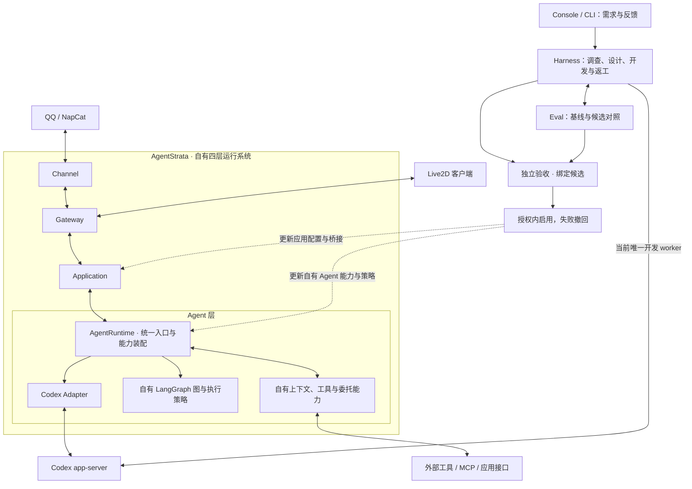
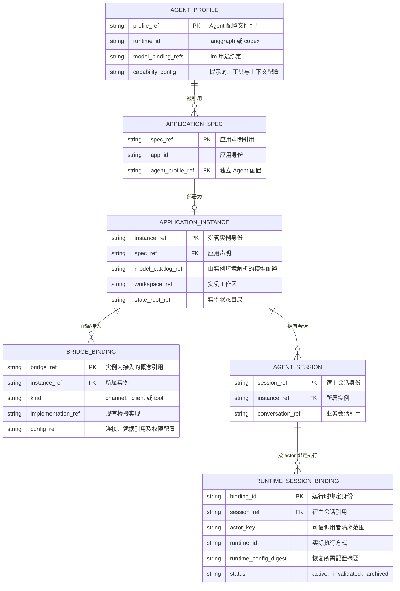
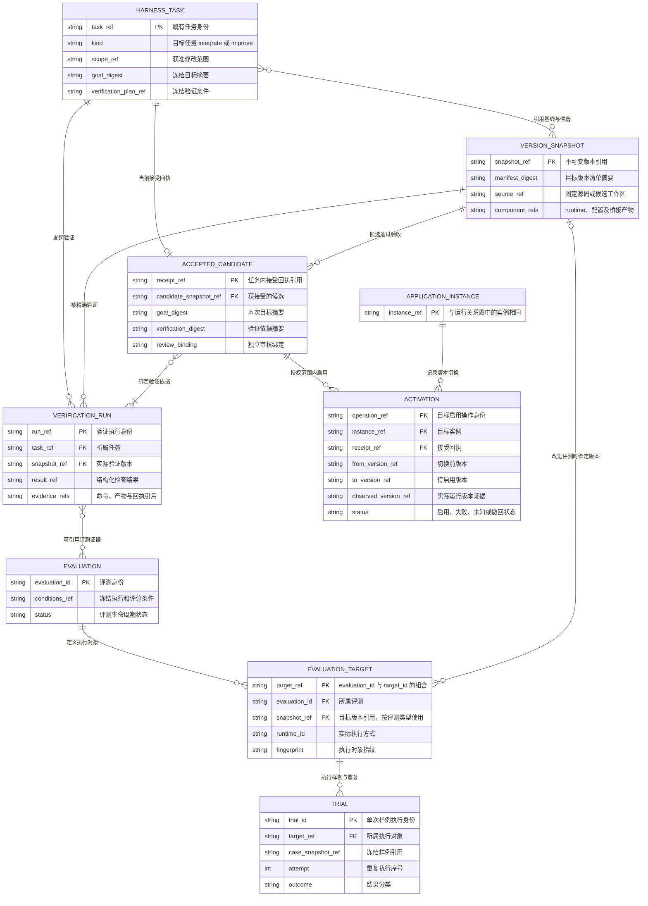

# AgentStrata 定制、运行与交付及自有能力优化

## Summary

AgentStrata 是面向外部应用的 Agent 定制、运行与交付系统。它提供自有基础 Agent 和运行底座，
通过 Harness 根据应用需求，对 Agent 能力及接入组件进行针对性开发与验证，最终交付能够在
目标环境运行的特化 Agent，以及配套的插件、适配器或其他接入组件。不同应用共享基础能力，
保留各自的特化配置与必要实现。自有四层架构继续承载应用接入、会话、上下文和 Agent 能力。
项目自行实现能力装配、上下文组织、工具使用，以及基于 LangGraph 的执行循环与协作策略；
这些自有实现都是 Harness 的主要优化对象。Harness 根据需求开发适配、能力模块和运行策略，
通过 Eval 与独立验收验证改进。Codex 通过公开接口作为可选执行器接入，近期继续作为 Harness 的唯一开发 worker。

本规格是唯一主计划。M0—M7 已完成其实施与约定范围内验收，不表示所有平台和生产环境均已交付。
新增 M8 独立应用交付与本机改进在完成对应验收前保持未完成，不改写此前阶段的证据。
当前已完成 M0 定义与文档、M1 应用与 Agent 配置分离、M1.1 双 runtime 收敛、M2 外部桥接基线、M3 Agent 与桥接评测、M4 Harness 改进闭环、M5 已验收版本启用与撤回、M6 Console 改进工作台及 M7 真实闭环。A 的能力盘点与隔离基线、B 的能力发现候选、C 的真实 worker 开发与独立接受，以及 D 本次失败停止策略修复均已留证；精确候选已在隔离实例启用并撤回。
实现完成与运行实例部署分别验收。当前事实由[架构总览](../../docs/reference/architecture.md)及领域正文维护，
计划接口在实现前不进入快速开始。自有 Agent 的代码改进及后续验收沿本规格的 A—D 路线推进，已实现机制同步到对应领域正文。

自有 Agent 及其使用外部能力的效果是主要改进对象，执行循环从现在起就是正式优化对象。
优先解决能力、上下文和应用策略问题，只表示实施顺序，不将循环视为不可修改的底座。fork、构建和部署按具体接入需要使用；
已有 Live2D fork 方案可作为维护任务保留，不再作为 Agent 评测与优化的前置条件。
Live2D 与 QQ 从桥接基线阶段共同参与验证，每个应用默认拥有独立配置、模型绑定、人格、工具、
记忆和工作区。Console 与 CLI 是任务入口，需求与反馈触发改进，应用日常运行不依赖 Harness 在线。

首版沿用 WSL/Linux 受管环境，保持现有依赖与执行契约。模型权重训练、通用插件市场、
跨机器调度和 Windows 安装包自动升级不进入本计划。效果由任务指标和实际证据确认，
没有有效改善时保留现有版本。

## Design

### 产品主体与术语

| 概念 | 定义与边界 |
| --- | --- |
| Agent 运行系统 | Channel → Gateway → Application → Agent 四层整体，构成业务运行底座；Harness、Eval 与 Console 为应用提供通用改进、验证与控制能力 |
| 独立 Agent 应用 | 面向具体外部应用的特化 Agent 及必要接入组件，拥有明确版本、可独立部署，并可在本机继续优化 |
| AgentRuntime | Agent 层内现有的统一执行入口与共享能力装配，保留代码中的含义；不是四层整体的新类名 |
| 自有 LangGraph Agent | 项目编写的图、状态转换、上下文、工具执行与协作策略，属于产品能力，也是 Harness 的主要优化对象 |
| Codex | 通过公开接口接入的可选业务执行器，以及近期唯一 Harness 开发 worker；宿主能力可扩展，不承诺修改未开放的内部行为 |

LangGraph 库提供成熟的图执行基础设施，项目拥有基于它编写的 Agent 设计与实现。
Agent 图调度日常模型与工具回合，Harness 图调度调查、开发、验证和返工；两者分别维护。
定位修订不要求重命名 Python 类、配置键、CLI 参数或持久化字段，也不增加 runtime ID；
后续代码阶段沿现有宿主控制契约扩展验收与恢复能力。

### 重构起点与目标差距

| 领域 | 已有基础与源码入口 | 本计划补齐的能力 |
| --- | --- | --- |
| Agent 执行 | 已收敛为 LangGraph/Codex；自有 [LangGraph 会话](../../src/chatcopilot/agent/langgraph_session.py)与 [TurnOps](../../src/chatcopilot/agent/turn.py)实现模型/工具循环、预算与停止；[RuntimeAdapter](../../src/chatcopilot/contracts/runtime_adapter.py)定义执行契约 | 在实际控制流程缺口上优化自有图与策略，保持现有路由和权限边界 |
| 能力与上下文 | 已有[能力装配](../../src/chatcopilot/agent/capabilities/assembly.py)、[工具发现](../../src/chatcopilot/agent/tools/disclosure.py)、[PromptPlan](../../src/chatcopilot/agent/context/prompt_plan.py)与会话上下文入口 | 测量外部能力发现、参数选择和上下文使用，依据缺口形成自有 Agent 实现候选 |
| 应用与配置 | M1 已分离 [ApplicationSpec、AgentProfile](../../src/chatcopilot/contracts/application.py)，复用 BotSpec 装配与实例状态 | 保持连接配置与 Agent 配置分离，按需扩展接入信息 |
| 外部桥接 | [QQ OneBot](../../src/chatcopilot/channels/qq_onebot/driver.py)、[VTuber](../../integrations/open_llm_vtuber/README.md)、ToolRegistry 与 MCP | 整理能力、权限、取消、回执与接入验证 |
| Harness | [修复图](../../src/chatcopilot/harness/engine/repair_graph.py)、[验收图](../../src/chatcopilot/harness/engine/acceptance_graph.py)、[adapter_forge](../../src/chatcopilot/component_catalog/subagents.py) | 复用调查、开发、验证、返工与验收图，支持新增接入和需求改进 |
| Eval | [评测模型](../../src/chatcopilot/evals/models.py)管理 Case、Target、Trial、条件与证据；M3 桥接 Suite 与版本对照复用其生命周期 | 扩展具体改进场景，取得真实模型、外部交付与改进归因证据 |
| 实例与交付 | [插件管理器](../../src/chatcopilot/plugins/service.py)、[源码交付](../../docs/reference/delivery.md) | 精确绑定验收候选、启用产物和实际运行版本，支持失败撤回 |

现有外部软件的固定上游加补丁、安装管理仍由[插件规格](../external-software-plugins/spec.md)维护。
受管 fork 或部署机制只在对应实现完成后更新，不因主计划改变提前宣称通用仓库自动接入已实现。

### 职责与数据流

遵循[四层运行时](../runtime-four-layer-definition/spec.md)和[六层依赖](../domain-layered-dependencies/spec.md)。
四层共同承载身份、准入、权限、工具注册、上下文、会话和交付；AgentRuntime 在 Agent 层选择一次回合的执行实现。
Harness 与 Eval 在消息链之外运行，使用冻结宿主与规则，候选实现由后续任务加载。



需求候选、版本切换与 Console 工作台已有共享控制接口；自有 Agent 的真实改进闭环按 M7 验收。
日常回合由配置选择一个 runtime，不要求每条 Codex 请求先经过 LangGraph 的模型规划。

### 实体关系与实现映射

本节是领域级 ERD，说明业务对象的身份、归属和引用，不是新增数据库表清单。
现有 YAML、JSON、SQLite、产物引用与 LangGraph checkpoint 沿原职责维护。
图中的 `PK/FK` 表示逻辑身份与引用；为阅读而使用的 `*_ref` 不要求新增同名字段或 UUID，
实际身份从已有应用、实例、任务和文件作用域解析。

#### 应用配置与运行关系



一份显式部署声明在本基线中对应零个或一个当前实例；插件包可以包含多份应用声明。
profile 默认由各应用独立持有，显式引用仍受现有路径和权限约束，配置复用不意味着共享状态。
模型绑定需与实例选择的模型配置一起解析，同名用途不能被当作跨实例全局身份；
人格、记忆和工作区数据由实例及宿主会话管理，profile 只声明能力和配置引用。

`BRIDGE_BINDING` 是现有接入配置的概念视图：QQ/NapCat 对应 OneBot Channel，
Live2D 对话对应认证 Gateway 客户端，动作对应 MCP/工具接口。
M2 沿这些接口工作，没有新增统一 Bridge 注册中心。
会话和绑定表示宿主的执行身份，不承诺所有 runtime 或客户端都拥有相同的持久化恢复能力。

模型执行、取消确认、provider acknowledgement 与客户端实际呈现分别留证。
发送回执经 `outbound_id` 关联宿主出站记录，执行记录按 `run_id` 查询；
客户端丢失原请求参数与幂等键后，最新 run 不能证明原来未确认的输入已执行。
具体恢复与交付边界以[桥接基线](../../docs/reference/runtime.md#外部桥接基线)为准。

#### 改进、验证与版本启用关系

下图同时包含已有 Harness/Eval 对象和后续扩展。M3 将源码、runtime、Target 与桥接组件身份绑定到
现有 Evaluation 快照；M5 将源码清单、编译检查与运行进程回执绑定到实例启用记录。
通用外部构建、依赖升级和数据迁移仍不因画入 ERD 而成为当前已实现接口。



基线与候选是任务对快照的使用角色，不是版本的永久属性；同一快照可以被不同任务引用。
首次接入可以没有既有应用基线，改进任务需冻结比较基线。
验证可以引用多个 Evaluation，也可以使用已有命令和产物检查，不要求把所有验证重包成评测任务。

Target 的局部 ID（例如 `codex`）不能充当全局主键，需连同 Evaluation 身份和 fingerprint 使用。
每次 Trial 还绑定冻结的 Case 定义与重复序号；图中的样例引用由既有定义快照提供，
不另建一套 Case 版本库。通用 Eval 可以独立于 Harness 运行；
针对代码、配置或桥接版本的改进评测必须绑定确切快照，不能用未绑定版本的结果接受候选。

接受回执绑定候选、目标、验证与独立审核。图示保留任务当前接受结果，历史产物沿现有记录机制保存。
`ACTIVATION` 专指 M5 的受管候选启用，普通插件安装仍使用原安装记录；
接受、源码交付、进程启动和运行版本核对分别记录，启用失败或结果未知时按实际回执处理。

#### 实现映射与约束

| ERD 概念 | 当前实现入口 | 实施边界 |
| --- | --- | --- |
| 应用与 Agent 配置 | [ApplicationSpec、AgentProfile](../../src/chatcopilot/contracts/application.py)、[BotSpec](../../src/chatcopilot/botspec/model.py) | M1 已有文件引用与装配；不新增全局 profile 注册表 |
| 实例与会话 | [实例装配](../../src/chatcopilot/botspec/runtime.py)、[Gateway 会话和 run 投影](../../src/chatcopilot/contracts/gateway_rpc.py) | 沿用宿主身份及状态作用域 |
| 运行时绑定 | [RuntimeSessionRef](../../src/chatcopilot/contracts/runtime_adapter.py)、[RuntimeSessionBinding](../../src/chatcopilot/contracts/execution.py) | M1.1 已有契约；恢复能力由 adapter 决定 |
| 桥接配置与回执 | [M2 桥接基线](../../docs/reference/runtime.md#外部桥接基线)、[出站与投递契约](../../src/chatcopilot/contracts/gateway.py) | 概念投影现有 Channel、Gateway 客户端和工具配置，不引入万能驱动或客户端任务数据库 |
| 版本与验证 | [CandidateRef、VerificationPlan、VerificationResult](../../src/chatcopilot/harness/models.py) | M3—M5 复用快照、模型/runtime 事实和独立验收身份，运行清单绑定实际加载组件 |
| Evaluation、Target、Case、Trial | [现有评测契约](../../src/chatcopilot/evals/models.py)、[版本快照](../../src/chatcopilot/evals/version_snapshot.py) | M3 复用生命周期与定义快照，加入桥接 Suite；版本身份存于 `config_snapshot.version_snapshot`，不新增表 |
| 候选接受 | [AcceptedCandidate](../../src/chatcopilot/harness/agent_types.py) | 沿用独立验收签发，按目标版本清单补齐绑定 |
| 版本启用 | [启用记录](../../src/chatcopilot/deployment/activation_repository.py)、[实例运维](../../docs/guides/instances.md) | M5 已实现源码版本准备、明确启用、运行核对、撤回与中断对账；既有安装与数据位置保持独立 |

引用可变配置文件不等于冻结了配置。比较与接受需绑定当时的内容摘要；
代码、runtime、配置或桥接产物改变后，旧回执不能直接用于新候选。
秘密只保存引用；角色、权限和资源作用域由宿主采信，不能由 profile 文本或桥接载荷自行授予。
checkpoint 只记录图执行位置，不能替代外部操作回执、用户可见交付或版本启用证据。

### 双 runtime 与 Native 退役

`AgentProfile.agents.runtime` 继续作为唯一执行选择，支持 `langgraph` 与 `codex`。
模型、认证和执行循环分别配置；改变 runtime 后新建运行时会话，不复用另一 runtime 的恢复绑定。
通用模板缺省为 LangGraph，已有明确选择 Codex 的配置保留选择。能力差异沿现有能力契约表达。

LangGraph 路径是深度运行策略定制的主线，能力装配、上下文、工具、图和委托实现都可成为候选修改范围。
Codex 通过 app-server 执行，
可优化宿主提供的提示词、工具、上下文、桥接和配置。Codex 内部线程、压缩和执行行为由其公开接口决定，
不能把外围配置改善描述为修改了 Codex 内部算法。

M1.1 移除 Native 独立循环、注册入口和有效配置选项，自有子 Agent 使用 LangGraph。
保留 AgentSession 的状态与辅助方法、TurnOps 的事件和工具语义，预算与取消在 LangGraph 回合中统一执行。
Codex 自身管理的原生子 Agent 不属于这次退役范围。具体路由由[路由规格](../agent-runtime-routing/spec.md)维护。

旧 Native 配置及配置历史标记废弃，不开发兼容别名、运行时回退或专门迁移器。
有效仓库配置与模板直接更新，旧配置给出重新配置诊断。`runtime_options.native` 退出，
同类进程内设置使用 `runtime_options.langgraph`。业务历史、人格、记忆和凭据保留，
旧执行绑定不续跑，历史证据保留原始 runtime 标识，不能改写为 LangGraph 结果。

### 开源复用与版本依据

实施基线沿用 [uv.lock](../../uv.lock) 中的 LangGraph 1.2.2、langgraph-checkpoint 4.3.0 和
langgraph-checkpoint-sqlite 3.1.2。本轮不升级依赖，首版使用这些版本已具备的公共 API。
下面的 LangGraph 对照源码固定到 `a25bfafe4858d2a85bede09ba83f9a591d1f1133`，
[该 revision 的包声明](https://github.com/langchain-ai/langgraph/blob/a25bfafe4858d2a85bede09ba83f9a591d1f1133/libs/langgraph/pyproject.toml)为 1.2.17；
它用于理解实现，不代表项目已使用 1.2.17。较新的中断响应 schema 等 API 不进入首版依赖。
Deep Agents 的参考固定到 `f26eb54c9b9f66d2ea7edbb9748413d58744534d`。

| 能力 | 源码入口 | 采用方式与边界 |
| --- | --- | --- |
| 状态、节点与条件分支 | [StateGraph](https://github.com/langchain-ai/langgraph/blob/a25bfafe4858d2a85bede09ba83f9a591d1f1133/libs/langgraph/langgraph/graph/state.py) | 直接依赖公共 API；图是唯一执行位置管理者，不重写图引擎 |
| 子图与依赖注入 | 同一 StateGraph 的 `add_node`、`compile`、`context_schema`；[官方子图说明](https://docs.langchain.com/oss/python/langgraph/use-subgraphs) | 两类任务复用开发与验收子图；资源通过 Runtime Context 注入，不进入 checkpoint |
| 持久化 | [SqliteSaver](https://github.com/langchain-ai/langgraph/blob/a25bfafe4858d2a85bede09ba83f9a591d1f1133/libs/checkpoint-sqlite/langgraph/checkpoint/sqlite/__init__.py) | 继续使用官方 saver；保留当前私有文件、执行锁与冻结图版本边界 |
| 等待与恢复 | [Command、interrupt](https://github.com/langchain-ai/langgraph/blob/a25bfafe4858d2a85bede09ba83f9a591d1f1133/libs/langgraph/langgraph/types.py) | 缺少必要输入或等待外部结果时中断；预授权范围内不逐阶段增加人工确认 |
| 瞬时故障重试 | 同一类型模块中的 `RetryPolicy` | 只重试可安全重放的操作；产品失败、无改善与重新规划使用业务分支 |
| 进度展示 | 现有 `graph.stream` 与 `get_state` | 复用查询投影；Console 不保存第二套下一阶段调度状态 |
| 候选改进 | [better-harness/core.py](https://github.com/langchain-ai/deepagents/blob/f26eb54c9b9f66d2ea7edbb9748413d58744534d/examples/better-harness/better_harness/core.py) | 借鉴工作区、可修改范围、基线和诊断反馈；保留项目独立验收与关键行为保护 |

checkpoint 负责恢复图位置，不能证明 fork、模型执行、发布或部署只发生一次。中断恢复会重入节点，
副作用应放在可对账的操作边界，继续由宿主回执记录 `started/completed/failed/unknown`。
未知结果先查询原操作，不盲目重放；详见[官方中断说明](https://docs.langchain.com/oss/python/langgraph/interrupts)。

better-harness 的参考实现按 train 与 holdout 合计通过数决定保留候选，可能以局部退步换取总分上升；
其 [README](https://github.com/langchain-ai/deepagents/blob/f26eb54c9b9f66d2ea7edbb9748413d58744534d/examples/better-harness/README.md)
也明确可见与私有资料划分尚不是严格沙箱。项目借鉴其优化方法，不照搬接受条件和隔离方式。

[Deep Agents](https://github.com/langchain-ai/deepagents/tree/f26eb54c9b9f66d2ea7edbb9748413d58744534d/libs/deepagents)
提供上下文、工具与子 Agent 的组织参考；[GEPA](https://gepa-ai.github.io/gepa/api/optimize_anything/optimize_anything/)
可作为后续候选搜索策略；[Harbor](https://docs.harborframework.com/agents/custom-agents)可作为外部执行环境适配参考。
这些不是首版新增的强依赖。增加依赖前必须指出它替代的实际代码或补足的缺口，并核对权限、取消和证据语义。


### OpenClaw 的参考与采用边界

固定参考版本为 `672c4357a65aa960e1fcf2be3fecf47d56c25f37`。
OpenClaw 区分渠道、provider、model 与 runtime，自身运行器和 Codex 都能执行 Agent 回合：
[运行时职责源码](https://github.com/openclaw/openclaw/blob/672c4357a65aa960e1fcf2be3fecf47d56c25f37/docs/concepts/agent-runtimes.md)、
[内置运行器](https://github.com/openclaw/openclaw/blob/672c4357a65aa960e1fcf2be3fecf47d56c25f37/src/agents/harness/builtin-openclaw.ts)、
[Codex 插件注册](https://github.com/openclaw/openclaw/blob/672c4357a65aa960e1fcf2be3fecf47d56c25f37/extensions/codex/index.ts#L267)。

Codex 拥有原生模型循环、线程恢复和压缩，OpenClaw 负责动态工具、权限接入、渠道交付与记录投影，
见[Codex 运行契约](https://github.com/openclaw/openclaw/blob/672c4357a65aa960e1fcf2be3fecf47d56c25f37/docs/plugins/codex-harness-runtime.md)。
项目借鉴宿主与循环的分工，继续使用现有 RuntimeAdapter 和实例配置，不引入 OpenClaw 依赖。
上游这里的 harness 是运行器实现；本项目 Harness 还负责调查、开发、对照评测和独立验收。

### 最小公开契约

| 契约 | 职责与边界 |
| --- | --- |
| `ApplicationSpec` | 应用连接与身份信息、Agent 配置引用；实际需要修改上游时再加入相关源码和产物信息 |
| `AgentProfile` | runtime、模型绑定、提示词、工具与上下文配置；凭据只保存引用，状态属于实例 |
| `RuntimeAdapter` | 沿用会话、回合、事件、取消和恢复契约，各 runtime 声明能力 |
| Harness `integrate` | 外部能力、接口或仓库线索、接入目标和 Agent 配置，产出可验证桥接候选 |
| Harness `improve` | 自有 Agent、提示词、上下文、工具、Skill 或桥接的改进目标与反馈 |
| 候选身份 | 自有代码、runtime 版本、Agent 配置及参与的桥接产物；外部源码仅在实际参与时纳入 |
| 桥接接口 | 复用 Channel、Gateway 客户端、ToolRegistry 与 MCP，按职责提供消息、动作或生命周期能力 |

不要求每个桥接都实现完整的源码准备、构建、部署和撤回接口。外部项目优先经现有协议连接，
确需修改上游时在获准范围开发受管 fork。平台逻辑留在桥接层，Harness 核心不加入平台分支。

应用、Harness 编程 worker 和 Eval 评分模型分别绑定。近期开发 worker 只使用 Codex，
该角色独立于被优化实例的 runtime，可开发和验证 LangGraph Agent 候选。
不同时开发 LangGraph 编程 worker 或增加 worker 调度体系。Console 与 CLI 的 `integrate`、`improve` 共用既有控制与查询入口。

### M1 配置分离的实现边界

应用入口沿用 `bot.yaml`，通过 `agent_profile` 引用独立 YAML；`llm/prompts/tools/agents/context`
移入 profile，身份、渠道、工作区与部署归应用。声明由 Core 公共解析器读取，供运行、Console 和 MCP 管理复用，
纯数据对象放在 Contracts。既有 BotSpec 是合成后的类型化装配视图，字段验证、RuntimeAdapter、模型解析和
实例状态管理继续复用，不增加另一套执行器或旧文件兼容加载器。

Agent 资源按 profile 所在目录解析，打包清单按应用目录解析。新建应用使用独立的用途名，
Live2D 新安装为 LangGraph、Codex 保存实例模型快照；已有配置的显式共享引用在迁移时保留。
模型用途、实例数据目录和上下文权限的事实由原解析器与宿主继续管理。

`botspec migrate-profile` 默认预览，`--apply` 保存私有原文备份，先写 profile 再替换应用引用；
冲突或源文件变化阻断覆盖，中断后只复用相同内容。不会修改凭据、用户数据或运行服务。
文件字段、路径规则和迁移步骤分别由[配置正文](../../docs/reference/configuration.md)与
[实例运维](../../docs/guides/instances.md#迁移内联-agent-配置)维护；任务库切换由既有 Harness `cutover` 负责，不混入 profile 迁移。

### 两类任务与接受条件

首次接入：能力与接口调查 → 接入设计 → 桥接开发 → 接入评测 → 独立验收 → 授权内启用。
仓库地址是调查材料，接入目标需明确；只有确需改变应用行为时才修改受管外部源码。
Live2D 复用 Gateway 对话与动作工具接口，QQ/NapCat 复用 OneBot 渠道。

后续改进：需求或反馈 → 冻结当前版本与目标 → 调查开发 → 对照评测与回归保护 → 独立验收 → 启用。
两类任务共享开发与验收子图。新增功能不要求先有故障，故障修复仍需有效失败对照。
原有代码治理、Skill 学习和权限边界继续有效。

Eval 分别确认 Agent 任务完成、桥接接口与权限、外部执行与实际交付。两个 runtime 各自建立基线；
模型、runtime 或环境差异需记录，不能把模型更换收益归因于代码。关键行为退步不能由总分上涨抵消，
证据不足与环境失败单列。验证规则由宿主冻结，候选不得改写评分或自行签发接受回执。

### 源码、授权与版本启用

复用现有受管工作区与来源绑定。Live2D fork 和上游补丁迁移按需独立开展，不阻塞 Agent 改进基线；
上游升级与功能改进分别评估。源码、构建、Git 交付、实例启用和应用实际行为分别记录。

宿主冻结仓库、可改范围、实例、资源和预算授权，候选声明不能扩大授权。
主计划不授权交互式协作者执行远端 Git、发布或生产部署操作。

M5 沿现有实例与插件管理准备独立候选，等待可切换状态，启用后核对实际加载身份和服务就绪；真实外部行为继续由 M7 验收。
失败恢复上一可用版本，实际运行身份需对应验收候选；持久数据格式变化另行验证恢复，
源码回退不能替代数据恢复。

### 分阶段开发

依次推进 M0 → M1 → M1.1 → M2 → M3 → M4 → M5 → M6 → M7。
阶段状态只记录完成条件；单次日志、测试计数与运行结果留在交付或 CI。

#### M0 定义与文档

- 状态：已完成；本轮修订产品定义、自有 Agent 优化范围、架构图与后续阶段。
- 交付：主计划、根 README 与 AGENTS、导航、规格索引和架构概览，不另建 ROADMAP。
- 验收：四层运行系统是产品主体，自有 LangGraph Agent 是正式优化对象；说明可选 Codex 执行与开发 worker 的区别，文档检查通过。
- 文档：保留有效安装步骤、截图及证据说明。

#### M1 应用与 Agent 配置分离

- 前置：M0；状态：已完成，运行实例按显式配置拆分流程切换。
- 交付：独立应用与 Agent 配置、复用装配与实例状态；不因定位变化重做。
- 验收：Live2D 与 QQ 的模型、人格、工具、记忆和工作区独立，Harness 与应用模型互不覆盖。
- 文档：配置、实例与 Agent 正文维护当前字段和迁移步骤。

#### M1.1 双 runtime 收敛

- 前置：M1；状态：已完成；运行实例重新配置后按部署流程切换。
- 交付：Native 退役、共享会话整理、自有子 Agent 使用 LangGraph、模板与评测目标更新。
- 验收：有效执行路径仅 LangGraph/Codex；废弃配置有诊断；预算、取消、工具权限与会话隔离成立；
  现有 Codex 选择保留，历史证据不改写，跨 runtime 恢复被拒绝。
- 文档：同步路由规格、Agent、配置、Runtime、Eval、安装模板和首页状态。

#### M2 外部桥接基线

- 前置：M1.1；状态：已完成，受控生产装配基线成立；真实模型与外部对端的闭环证据范围见 M7。
- 交付：整理已有 Live2D、QQ 的连接配置、能力、权限、取消、回执及验证，fork 工作按需独立列出。
- 验收：两类接入可绑定所选 runtime，平台细节留在桥接层。
- 文档：更新[桥接基线](../../docs/reference/runtime.md#外部桥接基线)、外部插件规格及两类接入指南。
- 实施切口：复用 Gateway RPC、OneBot Channel 与 MCP；安装器沿宿主契约校验 runtime/model，
  修正提交前停止、取消回执与迟到结果、发送中取消的待回执清理；
  Gateway 与 Agent 模型装配使用同一显式实例环境。
  使用[生产装配基线](../../tests/integration/test_application_bridge_baseline.py)和两个 runtime 的受控模型/provider 验证两类接入，
  真实模型、语音与 QQ 交付另行验收。

#### M3 Agent 与桥接评测

- 前置：M2；状态：已完成工程实现与受控验证；M7 补充真实模型闭环，浏览器、语音和 QQ 送达仍须按实际平台分别验收。
- 交付：复用 M2 的桥接与运行链用例，在既有 Eval 生命周期中建立两个 runtime、两类接入的评测基线、评分和候选对照。
- 验收：区分 Agent 错误、桥接错误、环境失败、交付证据缺失；候选无法改写接受规则。
- 文档：更新 Evaluation、服务协议、用例约束与相应指南。
- 实施：新增仓库受管适配源码的桥接 Suite，复用 Case/Target/Trial、进程监督和结果契约；
  runtime 由现有 Agent profile 选择，平台仅使用隔离本地对端，不发送真实 QQ。
  版本改进评测沿用服务的 code_source 冻结与受信评分覆盖；结果附带版本绑定，
  对照检查评分、模型和环境条件，分别报告改善、退步、环境失败及证据缺失，不签发接受回执。
  六个场景覆盖两类对话、动作、会话隔离、准入与未知交付；两个 runtime 复用同一冻结题目。
  评分与环境条件漂移、旧 Trial 移用、候选评分替换和已知行为退步均有回归保护；
  管理服务到受监督 Trial 的源码基线/候选验证使用本地模型替身，不能外推为真实模型能力成绩。
  已实现事实与操作只在 [Evaluation](../../docs/reference/evaluation.md#agent-与外部桥接评测)及[指南](../../docs/guides/evaluation.md#live2d-与-qq-桥接基线)维护。

#### M4 Harness 改进闭环

- 前置：M3；状态：已完成工程实现与受控验证；真实模型与隔离外部执行的改进证据见 M7。
- 交付：接入与改进任务复用调查、开发、验证、返工、验收图及 adapter_forge，提供 CLI。
- 验收：明确需求形成可审查候选与独立接受结论，取消、恢复与未知执行不盲目重放。
- 文档：更新 Harness 规格、编译图、领域正文和指南。
- 实施切口：`integrate`/`improve` 作为已有任务的应用需求来源，冻结当前源码、目标、实例和显式可写范围；
  复用原 LangGraph 角色与验收子图、操作回执和取消机制，沿 adapter_forge 的来源包络绑定调查材料。
  既有 Suite 目标或独立新需求测试构成目标检查，应用 Suite 保留回归保护；没有可测量差异不签发改善回执。
  本地候选保存独立补丁和接受回执，不自动创建提交、PR 或修改当前实例；实例启用由 M5 单独处理。

#### M5 已验收版本启用与撤回

- 前置：M4；状态：已完成工程实现、受控进程验证与故障恢复验证；M7 补充精确候选的实际隔离启用、真实模型回合与撤回证据。
- 交付：沿现有实例和插件管理启用 Agent 配置、自有代码或桥接产物，失败撤回。
- 验收：实际身份对应验收候选，进程中断和启用失败可恢复，持久数据变化另验恢复。
- 文档：更新插件部署、源码交付与实例运维正文。
- 实施切口：复用既有实例启动脚本、插件服务管理和 `AcceptedCandidate`，将基线与候选保存为独立源码版本，
  经私有版本指针选择实际运行代码与 Agent 配置。CLI 显式启用一个已登记实例，不更新操作者仓库或发布 Git。
  切换前暂停新任务准入并等待已有执行结束，记录切换意图，再停止、切换和启动；运行进程回执绑定精确版本。
  失败撤回上一版本，进程中断通过原切换记录对账；查询不推进操作。凭据、模型配置、会话和记忆留在原实例。
  首版不在切换中升级依赖或迁移持久数据；涉及这些变化的候选需要独立构建/迁移及恢复验收。

#### M6 Console 改进工作台

- 前置：M5；状态：已完成工程实现、共享控制入口及受控界面验证。
- 交付：实例与 runtime 选择、外部能力接入、需求反馈、候选对照、启用状态和取消入口。
- 验收：Console 与 CLI 共用控制接口，查询不推进任务，旧优化任务只读归档。
- 文档：更新 Console、观测与指南，界面验证后再更新截图说明。
- 实施：按应用已配置的 runtime 选择目标，提交接入/改进需求和源码范围；复用原任务详情、流程和命令日志，
  展示同一候选的基线、复测、独立确认与接受事实。实例及登记插件的准备、启用、撤回、取消和对账沿用 M5，查询不推进操作。
  旧记录按现有协议标记只读，状态库切换复用既有 `cutover`，不增加新的持久化格式或迁移器。

#### M7 真实闭环验证

- 前置：M6；状态：已完成。真实 Codex worker 生成自有 Agent 候选，冻结基线、候选及完整独立确认后，独立 Review 和宿主签发接受回执；隔离实例的精确版本启用、真实模型回合与撤回通过。
- 交付：从 Live2D 需求形成一个可测量的自有 Agent 能力或上下文候选，保留 QQ 与通用 Agent 回归保护，并验证桥接扩展场景。
- 验收：Harness 的 Codex worker 实际完成调查、开发和验证，取得绑定精确自有 Agent 候选的独立接受回执；
  在隔离 LangGraph 实例验证启用与撤回，源码、评测、接受和实际运行身份对应。增加平台能力无需在 Harness 核心写平台分支。
- 文档：现行机制进入领域正文，真实与受控证据分别说明；阶段状态留在本计划，README 保持产品介绍职责。
- 已有证据边界：Live2D `apply_pose` 与 `live2d-pose` 题目保留为桥接能力示例；一次调用执行表情与动作并保留逐项回执，
  能证明该项桥接效率目标，不能据此宣布自有 Agent 实现或循环已获优化。已有失败记录保持原样，单次运行证据不改写。
- 证据范围：真实模型通过生产 Gateway 与 LangGraph 装配运行，Live2D 动作接收方和 QQ/OneBot 对端采用隔离受控实现；
  不据此声明真实浏览器渲染、语音硬件、真实 QQ 送达或生产实例切换通过。环境失败、旧候选和未获接受的尝试均保留原记录。
  开发执行器以实际模型回合确认就绪，账户或模型目录查询不能替代；模型对照、外部执行、正式接受和实例启用分别留证。

#### M8 独立应用交付与本机改进

- 沿用现有运行、Console、Harness、Evaluation 和 M5 机制，调整开发仓库依赖、应用版本归属和安装更新入口。
- 首个交付使用 NapCat/OneBot；完整源码副本及内容清单支持独立安装，应用使用本机配置与业务数据。
- 本机对话反馈绑定实际应用版本，在隔离 worktree 中开发，经过原验收流程后显式启用或撤回。
- 验收覆盖无原 checkout 的安装、Console/Eval 使用、版本正确性和反馈更新；真实模型与 QQ 往返另行留证。
- 设计边界见[独立应用规格](../standalone-agent-applications/spec.md)，当前机制由[交付正文](../../docs/reference/delivery.md#独立应用交付与本机改进)维护。

### 自有 Agent 能力优化路线

本路线在现有主计划内细化 M7 与后续优化，不另建项目路线图或任务状态机。
A、B、C 依次推进；D 由具体控制流程缺口触发，循环从现在起就可作为优化对象，
不要求所有能力问题都经历一次循环重构。各阶段先核对现有实现，再决定最小变更。

| 阶段 | 前置与范围 | 交付和完成条件 | 文档更新 |
| --- | --- | --- | --- |
| A：建立自有 Agent 能力基线（已完成） | M0—M6；独立 LangGraph 实例，固定代码、配置、模型、权限和环境；盘点能力装配、发现、上下文、循环与委托 | 复用既有 Eval，记录当前能力、实际缺口、测量方法和可修改的自有实现位置；受控与真实证据分别标注 | Agent、上下文、工具和 Eval 正文维护核实的机制；实验数据留在私有产物 |
| B：首个能力与上下文适配案例（已完成） | A 的实际缺口；从 Live2D 外部能力发现与使用切入，保护 QQ 与通用行为 | 形成自有 Agent 能力或上下文实现候选，在可比条件下证明目标改善；仅增加外部适配器函数不满足该条件 | 更新受影响领域正文与用例说明，不将新目标写成已实现 |
| C：收口 M7 真实自主改进闭环（已完成） | A 的基线、B 的目标和独立规则已冻结，Codex worker 实际回合可用 | 真实 worker 调查、开发和验证；正式接受绑定精确候选，隔离实例启用/撤回及运行身份验证通过；工程候选不能代替 Harness 实际生成候选的证明 | 更新 M7 验收状态及相应操作指南，保留各层证据限制 |
| D：按需求深入循环与协作策略（本次停止策略修复已完成） | 问题定位到控制流程；沿同一来源冻结和验收机制开展 | 优化自有 LangGraph 图、TurnOps、停止/恢复或委托策略，每项变化有独立目标、对照和回归；不为展示自研而增加图节点或规划阶段 | 当前机制进入 Agent、上下文及相关规格，不扩写第二套计划 |

#### A 的基线组织与已确认缺口

A 已沿现有能力装配、ToolRegistry、PromptPlan、LangGraphAgentSession/TurnOps 和 SubagentRunner 核对实现。
`agentstrata-agent-tasks-v1` 的 `adaptation` 预设复用 8 道已有题，采用独立 LangGraph 配置，不新增题库生命周期或复制 runtime。
本地受控验证检查装配、发现、上下文、预算和已有 Eval 的执行事实；隔离 LangGraph 实例已取得桥接 Suite 的真实模型基线与候选证据。
`adaptation` 的预检和工程回归不等于其完整真实模型测评；具体能力收益仍需目标对照，正式接受由 C 验收。

一般工具/资料题已有覆盖；外部能力发现的专项对照由 B/C 完成。任意应用状态变化仍须按实际需求独立验证，不能由预设名称推定已具备。
循环已确认并在本地修正的缺口是：业务执行失败后穿插成功的工具目录查询会清除业务失败累计，延后原有停止策略。
修复复用 TurnOps 的原有计数，仅实际业务成功才清除累计；查询不占用业务调用次数的原语义保持。
对应回归同时检查目录读取及其错误不能掩盖业务失败、实际业务恢复后可以继续。该项是 D 的局部运行策略修复，与 B 的发现改进一起进入 C 的真实候选；不能单独替代能力适配或独立接受。

| 能力轴 | 当前实现与测量方式 | 缺口及下一步 |
| --- | --- | --- |
| 能力装配 | 复用 runtime/session provider、统一 Registry 与权限投影；按组件来源、有效工具集合及执行副作用核对 | 当前受控装配回归未复现新的装配故障；不新增注册或配置层 |
| 工具发现 | 现有 search/describe/call 路径与真实 ToolExecutor，检查相似工具、schema、角色和实际调用 | 组合需求排序、参数名发现、工具包检索及新会话目录作用域已有定向回归，候选通过 C 的独立接受 |
| 上下文 | 唯一 PromptPlan、session 更新、ContextManager 与会话结果引用，检查更正、隔离和资料注入 | 不将文本或历史能力声明当作当前授权；需要外部应用状态变更的真实任务基线 |
| 循环与停止 | LangGraph 的模型/工具节点与 TurnOps；失败、发现、真实恢复分别留证 | 目录查询不再清零业务失败累计；该自有策略修改已随 C 候选独立接受 |
| 委托 | 复用 SubagentRunner 及现有隔离委托题，核对实际调用、范围与明确预算 | 不因存在委托工具而推定真实模型已正确委托，结果需任务产物支持 |

A 的基线、B 的发现改进与 D 的停止策略分别留证。C 已完成完整独立确认、Review、绑定候选的正式接受与隔离实例启用/撤回。历史模型或环境失败保持原样，不由后续成功结果覆盖；D 的其他循环与协作变化继续由具体需求触发。

#### B 的组合能力发现案例

工程实现、受控对照、Harness 实际生成候选及 C 的完整独立确认和正式接受已取证。
首个切口保持 Live2D 当前工具实现不变：同时要求 expression 与 motion 时，原目录排序把只覆盖其中一项的名称命中排在组合能力前。
自有发现实现优先覆盖查询词项，结合当前输入 schema 的参数名并保留工具包检索；具体排序由[工具正文](../../docs/reference/tools.md#工具按需披露)维护，没有增加平台分支、适配器函数或注册中心。

[适配回归](../../tests/integration/test_agent_capability_adaptation.py)使用真实 AgentRuntime、当前 MCP schema 和 Live2D 控制器，
受控模型依据实际检索结果选择能力、读取参数、执行并核对逐项回执。另检查成员不能由文本自称 Owner 获权，
以及新会话只消费本次目录；不将新会话验证描述成原会话热更新。
一般 Agent、QQ、取消、未知交付和四个信任分区继续由现有保护集验证。
该案例首先证明检索与受控使用链的改善，不宣称真实模型智力或真实浏览器效果已经提升。
正式 C 任务冻结目标和保护集，从未包含 B/D 产品修改的实际源码基线出发，由 Codex worker 生成候选。
后续审查补修与 worker 原候选分别记账；源码变化形成新的交付身份，不能沿用旧候选的验证或接受回执。

#### 现有实现与基线入口

| 能力 | 已有实现，A 阶段直接复用 | 需要测量的效果 |
| --- | --- | --- |
| 能力装配 | [AgentRuntime](../../src/chatcopilot/agent/runtime.py)、[能力装配](../../src/chatcopilot/agent/capabilities/assembly.py)、ToolProvider 与 ToolRegistry | 应用及会话所需能力可用，未授权能力不产生副作用 |
| 工具发现与使用 | [按需披露](../../src/chatcopilot/agent/tools/disclosure.py)、[ToolExecutor](../../src/chatcopilot/agent/tools/executor.py) | 相似工具选择、参数正确性、不可用与错误处理 |
| 上下文组织 | [PromptPlan](../../src/chatcopilot/agent/context/prompt_plan.py)、[上下文管理](../../src/chatcopilot/agent/context/manager.py)、[Application 会话](../../src/chatcopilot/application/actor_runtime.py) | 当前应用资料使用、更新与隔离、信任分区保持 |
| 模型与工具循环 | [LangGraphAgentSession](../../src/chatcopilot/agent/langgraph_session.py)、[TurnOps](../../src/chatcopilot/agent/turn.py)、[AgentSession](../../src/chatcopilot/agent/session.py) | 当前模型/工具两类节点、条件路由、取消、收尾及预算行为，不假定已有额外规划节点 |
| 委托 | [SubagentRunner](../../src/chatcopilot/agent/subagents/runner.py)及既有委托工具 | 任务与工具范围、明确轮次/工具次数/时间预算、结果回传 |

直接 Agent 基线复用[现有 Agent 任务题库](../../src/chatcopilot/evals/suites/agentstrata-agent-tasks-v1/README.md)，
优先复查 `decision-select-tool`、`decision-similar-tools`、`tool-disabled-hidden-no-effect`、
`tool-error-bounded-recovery`、`context-correction`、`evidence-select-source` 及隔离/注入相关用例。
应用效果复用[桥接题库](../../src/chatcopilot/evals/suites/agentstrata-application-bridges-v1/README.md)。
这些用例的存在不代表新目标已被完整覆盖；只为已证明的缺口补题，沿既有 Case/Target/Trial 管理。

#### 首个案例与对照设计

首个案例固定为“外部能力与上下文适配”。在任务开始前冻结目标、评分和保护集，覆盖：

- 相似工具存在时，选择与当前任务相关的工具和正确参数。
- 工具不可用、未授权或缺少必要信息时，按现有非交互执行契约安全处理并如实说明限制，不扩大权限或虚构参数。
- 外部能力或应用上下文变化后使用当前信息，不沿用另一应用或旧会话内容；平台状态留在桥接/应用侧，Agent 消费通用契约。
- 外部资料中的指令不能提升为宿主规则；任务完成结论依据实际结果和回执。

固定外部工具实现、任务数据、模型和环境，将 Agent 侧能力装配、工具呈现与发现、上下文组织作为改进变量。
任务完成、工具/参数正确性、上下文使用与实际效果是主要指标；调用次数、上下文量、延迟与费用作为对应任务的辅助指标。
沿既有重复验证机制执行基线、候选和独立确认；模型、runtime 或环境改变需单独记账，不能将其收益归因于 Agent 代码。
共享能力修改保留 QQ、通用 Agent 以及受影响 Codex 路径的回归保护，LangGraph/Codex 各自建立可比基线。

优先扩展 ToolProvider、ToolRegistry、工具发现接口、PromptPlan 和会话上下文入口。
不新增能力 DSL、工具注册中心、第三套 Native 路径或每应用一份完整 runtime。
纯配置调整、外部桥接扩展和自有 Agent 实现变更分别记账，前两类不能替代本次自有 Agent 候选的验收证明。
若基线已满足目标且无有效改善空间，记录“无需改动”，保留当前版本；不人为制造缺陷或无效补丁，
该案例也不能被写成 M7 已完成一次有效改进，可依据新的实际需求再选择目标。

#### 执行前置与范围

保留现有 LangGraph 默认模板及明确选择 Codex 的实例，新的自有 Agent 验收使用独立 LangGraph 实例，
不迁移生产实例。近期 Harness 开发 worker 只使用 Codex，沿现有 AgentRunner 和模型绑定执行。
Codex 工作区路由问题单独诊断，正式任务前以隔离的实际模型回合确认就绪；账户或模型目录查询不能替代该检查。
每次新的真实试验重新冻结输入、源码、凭据使用范围、调用预算与时限，不继承已经消耗的实验授权。
验证、源码交付与实例启用分别授权，不默认提交、发布或切换线上实例。

### 迁移与维护

新协议保留业务历史、人格、记忆、凭据和模型引用。Native 配置历史废弃，不提供专门迁移器；
M1 已有的应用/profile 拆分工具保持原职责。旧优化任务只读归档，不将旧 checkpoint 交给新图续跑。
修改部署或持久格式时验证备份和恢复；开发不自动切换线上实例。

每阶段复核新抽象是否减少真实重复代码、是否重复 LangGraph 或现有宿主。
两类接入尽早参与验证，按[文档维护规则](../../docs/maintenance.md)更新唯一正文，
不为设想中的所有平台预建通用仓库改造或部署系统。

## Acceptance

- 项目介绍覆盖 Agent 定制、运行与交付，以四层系统承载业务运行，明确 AgentRuntime、自有 LangGraph Agent、Codex 与 Harness/Eval 的边界。
- 自有能力装配、上下文、工具、LangGraph 循环与协作策略都是正式优化对象；优先顺序不排除循环修改。
- Native 不再作为有效执行路径，自有子 Agent、默认模板和有效评测目标完成收敛。
- 应用与 Agent 配置独立，日常运行不依赖 Harness，两个 runtime 的优化边界清楚。
- 接入与改进使用现有协议和契约；受管 fork 仅在实际需要时进入获准范围。
- 需求可产生候选，基线、受保护行为、评分和实际证据共同决定接受与启用。
- 无改善、退步、评分漂移和证据不足不会自动生效，未知副作用不盲目重放。
- 用户数据完整，历史证据不改写，实际运行版本对应验收候选。
- Live2D 需求产生 Harness 实际开发并正式接受的自有 Agent 实现候选；QQ 与通用行为受保护，改进可归因于固定条件下的 Agent 侧变化。
- 隔离实例的启用与撤回核对精确运行身份；桥接扩展、配置调整和历史失败记录不能替代 M7 的自有 Agent 闭环证据。

## Verification

文档修订执行：

```bash
.venv/bin/python scripts/check_sdd_specs.py
.venv/bin/python scripts/check_repo.py docs
```

代码阶段按[开发指南](../../docs/guides/development.md#选择检查范围)执行定向测试和 full。
共享核心变更按实际影响运行 Live2D、生成器及 Windows 桌面检查。
公开参考如需精确扫描来源清单，核对固定源码后维护，不忽略文件或关闭检查。

- 两个 runtime 的权限、工具、取消、会话隔离与结果语义，自有子 Agent 的任务和预算。
- 废弃配置拒绝、旧绑定不能续跑、历史标识保留，Codex 原生工具与线程功能不误删。
- 两类应用的模型、人格、记忆、工作区隔离，共享改进对另一接入的回归影响。
- 基线条件一致，受保护行为、缺失证据、环境失败、取消和未知结果正确分类。
- 外部能力与上下文案例覆盖相似工具、参数、不可用与未授权、缺信息、上下文更新、跨应用隔离和不可信指令；评分与验收规则不随候选修改。
- 主指标对应任务效果，调用次数等辅助指标不掩盖关键行为退步；沿现有重复验证覆盖基线、候选与独立确认。
- 版本启用、失败撤回与必要数据恢复，旧任务不续跑且业务历史完整。

真实模型、浏览器动作、语音设备与 QQ 交付分别验收。模拟、静态或局部结果只证明各自覆盖范围，
观察到有效产品差异后才报告效果提升。测试日志不累积进本规格。
