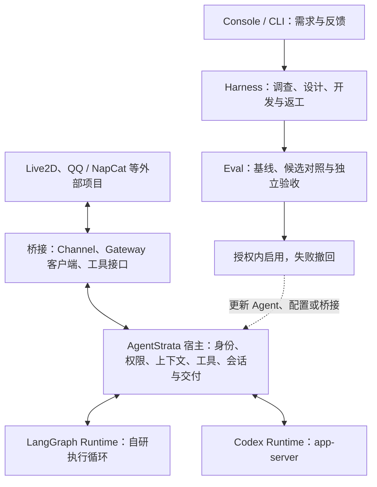

# AgentStrata 自研 Agent、外部桥接与持续改进

## Summary

AgentStrata 提供自研 Agent 系统、外部项目桥接能力，以及基于 Harness 与 Eval 的持续改进机制。
Agent 可通过 LangGraph 或 Codex 执行，连接 Live2D、NapCat 等可由 Agent 驱动的项目。
用户通过需求或反馈发起任务，由 Harness 完成调查、开发、对照评测和独立验收，
并在授权范围内启用通过验收的改进。

本规格是唯一主计划。`accepted` 表示设计可实施，不表示所有目标已完成。
当前已完成 M0 定义与文档、M1 应用与 Agent 配置分离、M1.1 双 runtime 收敛；M2—M7 待依次开发。
实现完成与运行实例部署分别验收。当前事实由[架构总览](../../docs/reference/architecture.md)及领域正文维护，
计划接口在实现前不进入快速开始。

Agent 及其使用外部能力的效果是主要改进对象。fork、构建和部署按具体接入需要使用；
已有 Live2D fork 方案可作为维护任务保留，不再作为 Agent 评测与优化的前置条件。
Live2D 与 QQ 从桥接基线阶段共同参与验证，每个应用默认拥有独立配置、模型绑定、人格、工具、
记忆和工作区。Console 与 CLI 是任务入口，需求与反馈触发改进，应用日常运行不依赖 Harness 在线。

首版沿用 WSL/Linux 受管环境，保持现有依赖与执行契约。模型权重训练、通用插件市场、
跨机器调度和 Windows 安装包自动升级不进入本计划。效果由任务指标和实际证据确认，
没有有效改善时保留现有版本。

## Design

### 重构起点与目标差距

| 领域 | 已有基础与源码入口 | 本计划补齐的能力 |
| --- | --- | --- |
| Agent 执行 | [RuntimeAdapter](../../src/chatcopilot/contracts/runtime_adapter.py)、[LangGraph 会话](../../src/chatcopilot/agent/langgraph_session.py)、[Codex adapter](../../src/chatcopilot/agent/runtimes/codex.py) | 收敛为两个 runtime，保留宿主共同契约和各自能力边界 |
| 应用与配置 | M1 已分离 [ApplicationSpec、AgentProfile](../../src/chatcopilot/contracts/application.py)，复用 BotSpec 装配与实例状态 | 保持连接配置与 Agent 配置分离，按需扩展接入信息 |
| 外部桥接 | [QQ OneBot](../../src/chatcopilot/channels/qq_onebot/driver.py)、[VTuber](../../integrations/open_llm_vtuber/README.md)、ToolRegistry 与 MCP | 整理能力、权限、取消、回执与接入验证 |
| Harness | [修复图](../../src/chatcopilot/harness/engine/repair_graph.py)、[验收图](../../src/chatcopilot/harness/engine/acceptance_graph.py)、[adapter_forge](../../src/chatcopilot/component_catalog/subagents.py) | 复用调查、开发、验证、返工与验收图，支持新增接入和需求改进 |
| Eval | [评测模型](../../src/chatcopilot/evals/models.py)管理 Case、Target、Trial、条件与证据 | 为两个 runtime 和两类接入建立能力、桥接及实际交付基线 |
| 实例与交付 | [插件管理器](../../src/chatcopilot/plugins/service.py)、[源码交付](../../docs/reference/delivery.md) | 精确绑定验收候选、启用产物和实际运行版本，支持失败撤回 |

现有外部软件的固定上游加补丁、安装管理仍由[插件规格](../external-software-plugins/spec.md)维护。
受管 fork 或部署机制只在对应实现完成后更新，不因主计划改变提前宣称通用仓库自动接入已实现。

### 职责与数据流

遵循[四层运行时](../runtime-four-layer-definition/spec.md)和[六层依赖](../domain-layered-dependencies/spec.md)。
宿主拥有身份、准入、权限、工具注册、上下文接入、会话路由和交付；runtime 执行一次 Agent 回合。
Harness 与 Eval 在消息链之外运行，使用冻结宿主与规则，候选实现由后续任务加载。



图中完整需求改进与自动启用仍为后续阶段目标。日常回合由配置选择一个 runtime，
不要求每条 Codex 请求先经过 LangGraph 的模型规划。

### 双 runtime 与 Native 退役

`AgentProfile.agents.runtime` 继续作为唯一执行选择，支持 `langgraph` 与 `codex`。
模型、认证和执行循环分别配置；改变 runtime 后新建运行时会话，不复用另一 runtime 的恢复绑定。
通用模板缺省为 LangGraph，已有明确选择 Codex 的配置保留选择。能力差异沿现有能力契约表达。

LangGraph 执行自有的模型与工具循环，可优化循环、上下文和停止策略；Codex 通过 app-server 执行，
可优化宿主提供的提示词、工具、上下文、桥接和配置。Codex 内部线程、压缩和执行行为由其公开接口决定，
不能把外围配置改善描述为修改了 Codex 内部算法。

M1.1 移除 Native 独立循环、注册入口和有效配置选项，自有子 Agent 使用 LangGraph。
保留 AgentSession 的状态与辅助方法、TurnOps 的事件和工具语义，预算与取消在 LangGraph 回合中统一执行。
Codex 自身管理的原生子 Agent 不属于这次退役范围。具体路由由[路由规格](../agent-runtime-routing/spec.md)维护。

旧 Native 配置及配置历史标记废弃，不开发兼容别名、运行时回退或专门迁移器。
有效仓库配置与模板直接更新，旧配置给出重新配置诊断。`runtime_options.native` 退出，
同类进程内设置使用 `runtime_options.langgraph`。业务历史、人格、记忆和凭据保留，
旧执行绑定不续跑，历史证据保留原始 runtime 标识，不能改写为 LangGraph 结果。

### 开源复用与版本依据

实施基线沿用 [uv.lock](../../uv.lock) 中的 LangGraph 1.2.2、langgraph-checkpoint 4.3.0 和
langgraph-checkpoint-sqlite 3.1.2。本轮不升级依赖，首版使用这些版本已具备的公共 API。
下面的 LangGraph 对照源码固定到 `a25bfafe4858d2a85bede09ba83f9a591d1f1133`，
[该 revision 的包声明](https://github.com/langchain-ai/langgraph/blob/a25bfafe4858d2a85bede09ba83f9a591d1f1133/libs/langgraph/pyproject.toml)为 1.2.17；
它用于理解实现，不代表项目已使用 1.2.17。较新的中断响应 schema 等 API 不进入首版依赖。
Deep Agents 的参考固定到 `f26eb54c9b9f66d2ea7edbb9748413d58744534d`。

| 能力 | 源码入口 | 采用方式与边界 |
| --- | --- | --- |
| 状态、节点与条件分支 | [StateGraph](https://github.com/langchain-ai/langgraph/blob/a25bfafe4858d2a85bede09ba83f9a591d1f1133/libs/langgraph/langgraph/graph/state.py) | 直接依赖公共 API；图是唯一执行位置管理者，不重写图引擎 |
| 子图与依赖注入 | 同一 StateGraph 的 `add_node`、`compile`、`context_schema`；[官方子图说明](https://docs.langchain.com/oss/python/langgraph/use-subgraphs) | 两类任务复用开发与验收子图；资源通过 Runtime Context 注入，不进入 checkpoint |
| 持久化 | [SqliteSaver](https://github.com/langchain-ai/langgraph/blob/a25bfafe4858d2a85bede09ba83f9a591d1f1133/libs/checkpoint-sqlite/langgraph/checkpoint/sqlite/__init__.py) | 继续使用官方 saver；保留当前私有文件、执行锁与冻结图版本边界 |
| 等待与恢复 | [Command、interrupt](https://github.com/langchain-ai/langgraph/blob/a25bfafe4858d2a85bede09ba83f9a591d1f1133/libs/langgraph/langgraph/types.py) | 缺少必要输入或等待外部结果时中断；预授权范围内不逐阶段增加人工确认 |
| 瞬时故障重试 | 同一类型模块中的 `RetryPolicy` | 只重试可安全重放的操作；产品失败、无改善与重新规划使用业务分支 |
| 进度展示 | 现有 `graph.stream` 与 `get_state` | 复用查询投影；Console 不保存第二套下一阶段调度状态 |
| 候选改进 | [better-harness/core.py](https://github.com/langchain-ai/deepagents/blob/f26eb54c9b9f66d2ea7edbb9748413d58744534d/examples/better-harness/better_harness/core.py) | 借鉴工作区、可修改范围、基线和诊断反馈；保留项目独立验收与关键行为保护 |

checkpoint 负责恢复图位置，不能证明 fork、模型执行、发布或部署只发生一次。中断恢复会重入节点，
副作用应放在可对账的操作边界，继续由宿主回执记录 `started/completed/failed/unknown`。
未知结果先查询原操作，不盲目重放；详见[官方中断说明](https://docs.langchain.com/oss/python/langgraph/interrupts)。

better-harness 的参考实现按 train 与 holdout 合计通过数决定保留候选，可能以局部退步换取总分上升；
其 [README](https://github.com/langchain-ai/deepagents/blob/f26eb54c9b9f66d2ea7edbb9748413d58744534d/examples/better-harness/README.md)
也明确可见与私有资料划分尚不是严格沙箱。项目借鉴其优化方法，不照搬接受条件和隔离方式。

[Deep Agents](https://github.com/langchain-ai/deepagents/tree/f26eb54c9b9f66d2ea7edbb9748413d58744534d/libs/deepagents)
提供上下文、工具与子 Agent 的组织参考；[GEPA](https://gepa-ai.github.io/gepa/api/optimize_anything/optimize_anything/)
可作为后续候选搜索策略；[Harbor](https://docs.harborframework.com/agents/custom-agents)可作为外部执行环境适配参考。
这些不是首版新增的强依赖。增加依赖前必须指出它替代的实际代码或补足的缺口，并核对权限、取消和证据语义。


### OpenClaw 的参考与采用边界

固定参考版本为 `672c4357a65aa960e1fcf2be3fecf47d56c25f37`。
OpenClaw 区分渠道、provider、model 与 runtime，自身运行器和 Codex 都能执行 Agent 回合：
[运行时职责源码](https://github.com/openclaw/openclaw/blob/672c4357a65aa960e1fcf2be3fecf47d56c25f37/docs/concepts/agent-runtimes.md)、
[内置运行器](https://github.com/openclaw/openclaw/blob/672c4357a65aa960e1fcf2be3fecf47d56c25f37/src/agents/harness/builtin-openclaw.ts)、
[Codex 插件注册](https://github.com/openclaw/openclaw/blob/672c4357a65aa960e1fcf2be3fecf47d56c25f37/extensions/codex/index.ts#L267)。

Codex 拥有原生模型循环、线程恢复和压缩，OpenClaw 负责动态工具、权限接入、渠道交付与记录投影，
见[Codex 运行契约](https://github.com/openclaw/openclaw/blob/672c4357a65aa960e1fcf2be3fecf47d56c25f37/docs/plugins/codex-harness-runtime.md)。
项目借鉴宿主与循环的分工，继续使用现有 RuntimeAdapter 和实例配置，不引入 OpenClaw 依赖。
上游这里的 harness 是运行器实现；本项目 Harness 还负责调查、开发、对照评测和独立验收。

### 最小公开契约

| 契约 | 职责与边界 |
| --- | --- |
| `ApplicationSpec` | 应用连接与身份信息、Agent 配置引用；实际需要修改上游时再加入相关源码和产物信息 |
| `AgentProfile` | runtime、模型绑定、提示词、工具与上下文配置；凭据只保存引用，状态属于实例 |
| `RuntimeAdapter` | 沿用会话、回合、事件、取消和恢复契约，各 runtime 声明能力 |
| Harness `integrate` | 外部能力、接口或仓库线索、接入目标和 Agent 配置，产出可验证桥接候选 |
| Harness `improve` | 自有 Agent、提示词、上下文、工具、Skill 或桥接的改进目标与反馈 |
| 候选身份 | 自有代码、runtime 版本、Agent 配置及参与的桥接产物；外部源码仅在实际参与时纳入 |
| 桥接接口 | 复用 Channel、Gateway 客户端、ToolRegistry 与 MCP，按职责提供消息、动作或生命周期能力 |

不要求每个桥接都实现完整的源码准备、构建、部署和撤回接口。外部项目优先经现有协议连接，
确需修改上游时在获准范围开发受管 fork。平台逻辑留在桥接层，Harness 核心不加入平台分支。

应用、Harness 编程 worker 和 Eval 评分模型分别绑定。Codex 可以担任开发 worker，
该角色独立于被优化实例的 runtime。Console 与 CLI 共用控制与查询入口；
`harness integrate`、`harness improve` 在落地前仅为设计名称。

### M1 配置分离的实现边界

应用入口沿用 `bot.yaml`，通过 `agent_profile` 引用独立 YAML；`llm/prompts/tools/agents/context`
移入 profile，身份、渠道、工作区与部署归应用。声明由 Core 公共解析器读取，供运行、Console 和 MCP 管理复用，
纯数据对象放在 Contracts。既有 BotSpec 是合成后的类型化装配视图，字段验证、RuntimeAdapter、模型解析和
实例状态管理继续复用，不增加另一套执行器或旧文件兼容加载器。

Agent 资源按 profile 所在目录解析，打包清单按应用目录解析。新建应用使用独立的用途名，
Live2D 新安装为 LangGraph、Codex 保存实例模型快照；已有配置的显式共享引用在迁移时保留。
模型用途、实例数据目录和上下文权限的事实由原解析器与宿主继续管理。

`botspec migrate-profile` 默认预览，`--apply` 保存私有原文备份，先写 profile 再替换应用引用；
冲突或源文件变化阻断覆盖，中断后只复用相同内容。不会修改凭据、用户数据或运行服务。
文件字段、路径规则和迁移步骤分别由[配置正文](../../docs/reference/configuration.md)与
[实例运维](../../docs/guides/instances.md#迁移内联-agent-配置)维护；M6 的任务库切换仍未进入本阶段。

### 两类任务与接受条件

首次接入：能力与接口调查 → 接入设计 → 桥接开发 → 接入评测 → 独立验收 → 授权内启用。
仓库地址是调查材料，接入目标需明确；只有确需改变应用行为时才修改受管外部源码。
Live2D 复用 Gateway 对话与动作工具接口，QQ/NapCat 复用 OneBot 渠道。

后续改进：需求或反馈 → 冻结当前版本与目标 → 调查开发 → 对照评测与回归保护 → 独立验收 → 启用。
两类任务共享开发与验收子图。新增功能不要求先有故障，故障修复仍需有效失败对照。
原有代码治理、Skill 学习和权限边界继续有效。

Eval 分别确认 Agent 任务完成、桥接接口与权限、外部执行与实际交付。两个 runtime 各自建立基线；
模型、runtime 或环境差异需记录，不能把模型更换收益归因于代码。关键行为退步不能由总分上涨抵消，
证据不足与环境失败单列。验证规则由宿主冻结，候选不得改写评分或自行签发接受回执。

### 源码、授权与版本启用

复用现有受管工作区与来源绑定。Live2D fork 和上游补丁迁移按需独立开展，不阻塞 Agent 改进基线；
上游升级与功能改进分别评估。源码、构建、Git 交付、实例启用和应用实际行为分别记录。

宿主冻结仓库、可改范围、实例、资源和预算授权，候选声明不能扩大授权。
主计划不授权交互式协作者执行远端 Git、发布或生产部署操作。

M5 沿现有实例与插件管理准备独立候选，等待可切换状态，启用后检查关键行为。
失败恢复上一可用版本，实际运行身份需对应验收候选；持久数据格式变化另行验证恢复，
源码回退不能替代数据恢复。

### 分阶段开发

依次推进 M0 → M1 → M1.1 → M2 → M3 → M4 → M5 → M6 → M7。
阶段状态只记录完成条件；单次日志、测试计数与运行结果留在交付或 CI。

#### M0 定义与文档

- 状态：已完成；本轮修订定位、架构图、参考依据与后续阶段。
- 交付：主计划、根 README 与 AGENTS、导航、规格索引和架构概览，不另建 ROADMAP。
- 验收：说明自研 Agent、双 runtime、桥接与评测改进，区分现状和目标，文档检查通过。
- 文档：保留有效安装步骤、截图及证据说明。

#### M1 应用与 Agent 配置分离

- 前置：M0；状态：已完成，运行实例按显式配置拆分流程切换。
- 交付：独立应用与 Agent 配置、复用装配与实例状态；不因定位变化重做。
- 验收：Live2D 与 QQ 的模型、人格、工具、记忆和工作区独立，Harness 与应用模型互不覆盖。
- 文档：配置、实例与 Agent 正文维护当前字段和迁移步骤。

#### M1.1 双 runtime 收敛

- 前置：M1；状态：已完成；运行实例重新配置后按部署流程切换。
- 交付：Native 退役、共享会话整理、自有子 Agent 使用 LangGraph、模板与评测目标更新。
- 验收：有效执行路径仅 LangGraph/Codex；废弃配置有诊断；预算、取消、工具权限与会话隔离成立；
  现有 Codex 选择保留，历史证据不改写，跨 runtime 恢复被拒绝。
- 文档：同步路由规格、Agent、配置、Runtime、Eval、安装模板和首页状态。

#### M2 外部桥接基线

- 前置：M1.1；状态：待开发。
- 交付：整理已有 Live2D、QQ 的连接配置、能力、权限、取消、回执及验证，fork 工作按需独立列出。
- 验收：两类接入可绑定所选 runtime，平台细节留在桥接层。
- 文档：更新运行链、外部插件规格及两类接入指南。

#### M3 Agent 与桥接评测

- 前置：M2；状态：待开发。
- 交付：既有 Eval 中建立两个 runtime、两类接入的基线与回归用例。
- 验收：区分 Agent 错误、桥接错误、环境失败、交付证据缺失；候选无法改写接受规则。
- 文档：更新 Evaluation、服务协议、用例约束与相应指南。

#### M4 Harness 改进闭环

- 前置：M3；状态：待开发。
- 交付：接入与改进任务复用调查、开发、验证、返工、验收图及 adapter_forge，提供 CLI。
- 验收：明确需求形成可审查候选与独立接受结论，取消、恢复与未知执行不盲目重放。
- 文档：更新 Harness 规格、编译图、领域正文和指南。

#### M5 已验收版本启用与撤回

- 前置：M4；状态：待开发。
- 交付：沿现有实例和插件管理启用 Agent 配置、自有代码或桥接产物，失败撤回。
- 验收：实际身份对应验收候选，进程中断和启用失败可恢复，持久数据变化另验恢复。
- 文档：更新插件部署、源码交付与实例运维正文。

#### M6 Console 改进工作台

- 前置：M5；状态：待开发。
- 交付：实例与 runtime 选择、外部能力接入、需求反馈、候选对照、启用状态和取消入口。
- 验收：Console 与 CLI 共用控制接口，查询不推进任务，旧优化任务只读归档。
- 文档：更新 Console、观测与指南，界面验证后再更新截图说明。

#### M7 真实闭环验证

- 前置：M6；状态：待开发。
- 交付：Live2D 一次可测量的 Agent 或工具使用改进，QQ 回归保护，桥接功能扩展验证。
- 验收：真实模型和外部执行证据能够归因改进；增加平台能力无需在 Harness 核心写平台分支。
- 文档：按真实支持范围更新首页、指南；硬件与实际交付缺口明确保留。

### 迁移与维护

新协议保留业务历史、人格、记忆、凭据和模型引用。Native 配置历史废弃，不提供专门迁移器；
M1 已有的应用/profile 拆分工具保持原职责。旧优化任务只读归档，不将旧 checkpoint 交给新图续跑。
修改部署或持久格式时验证备份和恢复；开发不自动切换线上实例。

每阶段复核新抽象是否减少真实重复代码、是否重复 LangGraph 或现有宿主。
两类接入尽早参与验证，按[文档维护规则](../../docs/maintenance.md)更新唯一正文，
不为设想中的所有平台预建通用仓库改造或部署系统。

## Acceptance

- 项目介绍准确区分自研 Agent、LangGraph/Codex runtime、外部桥接、Harness 与 Eval。
- Native 不再作为有效执行路径，自有子 Agent、默认模板和有效评测目标完成收敛。
- 应用与 Agent 配置独立，日常运行不依赖 Harness，两个 runtime 的优化边界清楚。
- 接入与改进使用现有协议和契约；受管 fork 仅在实际需要时进入获准范围。
- 需求可产生候选，基线、受保护行为、评分和实际证据共同决定接受与启用。
- 无改善、退步、评分漂移和证据不足不会自动生效，未知副作用不盲目重放。
- 用户数据完整，历史证据不改写，实际运行版本对应验收候选。
- Live2D 与 QQ 证明桥接及改进流程通用，真实改进可归因于具体变更。

## Verification

文档修订执行：

```bash
.venv/bin/python scripts/check_sdd_specs.py
.venv/bin/python scripts/check_repo.py docs
```

代码阶段按[开发指南](../../docs/guides/development.md#选择检查范围)执行定向测试和 full。
共享核心变更按实际影响运行 Live2D、生成器及 Windows 桌面检查。
公开参考如需精确扫描来源清单，核对固定源码后维护，不忽略文件或关闭检查。

- 两个 runtime 的权限、工具、取消、会话隔离与结果语义，自有子 Agent 的任务和预算。
- 废弃配置拒绝、旧绑定不能续跑、历史标识保留，Codex 原生工具与线程功能不误删。
- 两类应用的模型、人格、记忆、工作区隔离，共享改进对另一接入的回归影响。
- 基线条件一致，受保护行为、缺失证据、环境失败、取消和未知结果正确分类。
- 版本启用、失败撤回与必要数据恢复，旧任务不续跑且业务历史完整。

真实模型、浏览器动作、语音设备与 QQ 交付分别验收。模拟、静态或局部结果只证明各自覆盖范围，
观察到有效产品差异后才报告效果提升。测试日志不累积进本规格。
