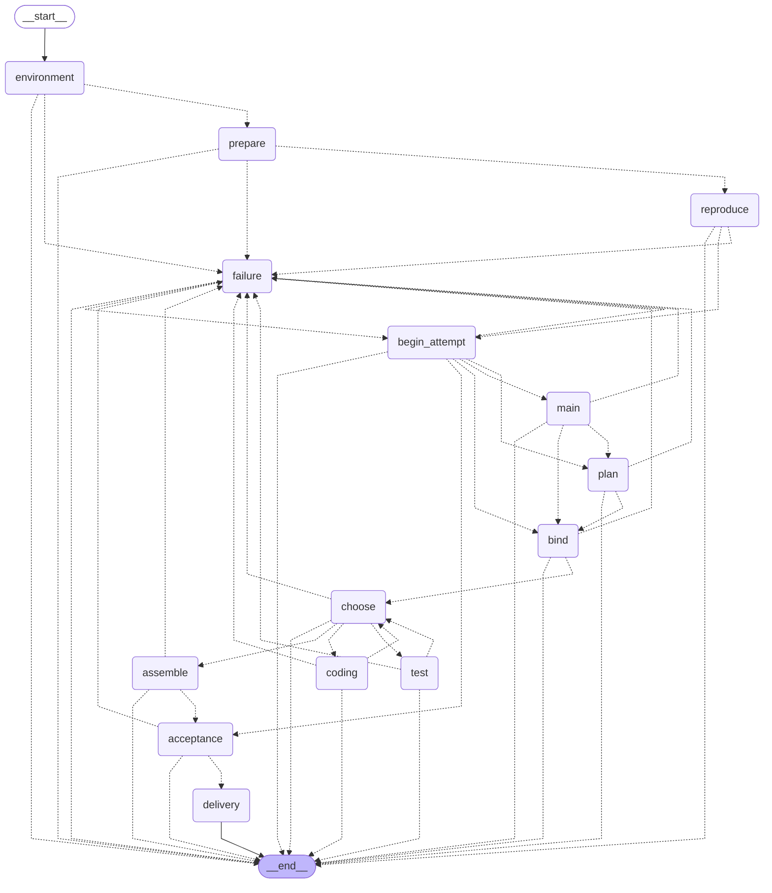
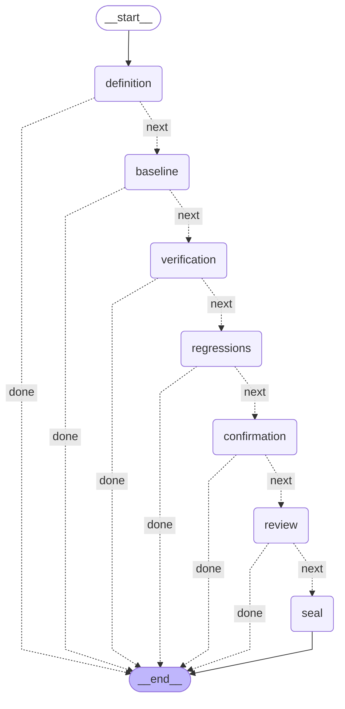
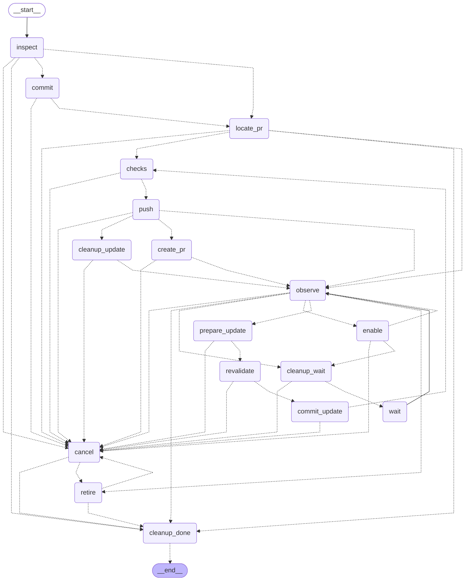
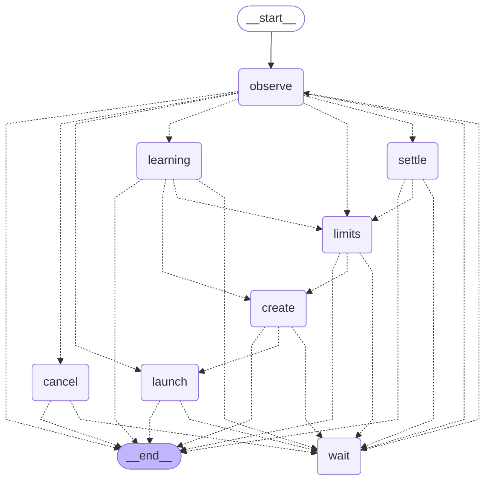

# Harness 编译图

由 `.venv/bin/python scripts/render_harness_graphs.py` 从实际 StateGraph 生成；使用 `--check` 检查是否与源码一致。这里只展示拓扑，不执行节点。状态、权限与恢复规则见 [Harness](../../docs/reference/harness.md)。

## 任务

## 共用验收

## 交付

## 代码熵回收批次

