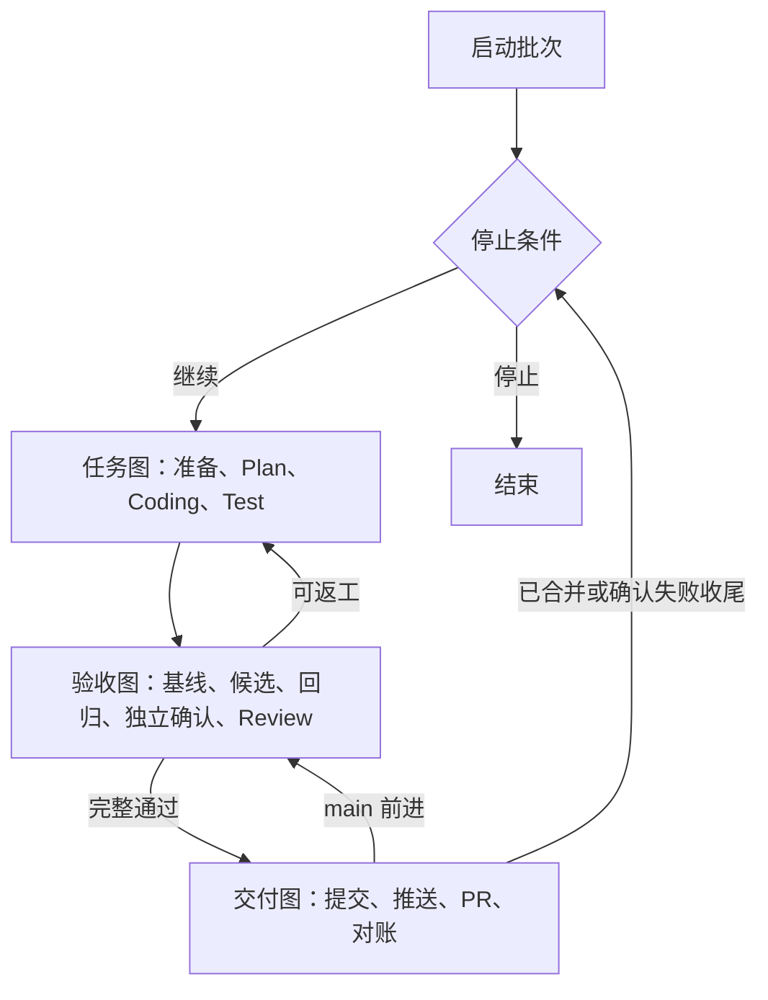

# Harness LangGraph 编排

## Summary

任务修复与独立验收由 `engine` 中的 LangGraph StateGraph 驱动；AgentStrata 来源、角色材料、
验证条件和治理规则归入 `integrations`。节点通过 `Runtime[HarnessContext]` 使用注入的执行
能力，运行依赖不进入 checkpoint。首次验收与主干复验复用验收图。

协议 12、图版本 2 分开保存修复、验收、交付和批次状态。图持有执行位置，宿主继续拥有
身份、权限、预算、不可变证据和外部操作回执。旧历史导出并校验后启用空活动库，旧任务不续跑。

## Design

遵循[四层运行时](../runtime-four-layer-definition/spec.md)、
[六层依赖](../domain-layered-dependencies/spec.md)及
[控制生命周期](../harness-control-lifecycle/spec.md)。Harness 继续是消息链外的独立宿主。
Types 定义可序列化状态及执行端口，Repo 保存 checkpoint 与证据；Service 定义业务图、
节点和条件路由；Runtime 注入执行器、checkpointer、工作区和进程能力；Console 使用公开入口。

### 核心与项目集成

修复核心包含纯状态、执行端口、图定义、修复/验收/失败节点与验证执行。节点直接注册到
StateGraph，返回状态增量，不使用大调度对象按名称查找方法。`HarnessContext` 在调用时注入
场景规则、角色协调、Verifier、候选工作区、仓储与预算，不进入 checkpoint。

AgentStrata 场景规则处理来源、角色材料、验证绑定和审核附加要求。故障修复与代码熵治理
是两个固定实现；不增加插件发现系统。具体 Codex、Eval、工作区、worker 及交付实现由宿主
装配。核心不能经帮助模块间接依赖这些实现，依赖规则纳入现有架构检查器。

### 状态与副作用

RepairState、AcceptanceState、DeliveryState、BatchState 分别声明状态范围。修复与验收
图有显式输入输出，验收子图按调用独立初始化并继承检查点。状态保存当前候选、计划、结果和
审核的不可变引用；完整正文留在产物仓储。终态图重新启动时清除旧错误与结论，未完成节点则
按已有 checkpoint 恢复，不重置其执行位置。

操作回执统一存于任务的 `operations`，绑定逻辑操作、轮次与输入摘要，并保存独立的操作 ID。
started 表示已登记但尚未确认结果，completed 表示已持久化结果，failed 表示明确失败，unknown
表示仍需对账。回执更新使用业务库事务，不能覆盖已完成结果，也不能复活已取消任务。

检查点丢失时优先使用已完成回执。没有可对账外部 ID 的未知执行不得重放；Evaluation 使用原 ID
核对或幂等提交。交付复验的可重复只读准备与外部模型/评测操作分别处理。私有回执不直接暴露
给 Console；公开阶段与结果继续由现有投影提供。

实际拓扑见[从 StateGraph 生成的编译图](graphs.md)，更新图定义后重新生成并用 `--check` 核对。

Plan 首轮直接调查并提出一个问题及最小方案；Main 仅处理根因变化或分歧。
宿主核对并冻结 finding 后按 test_first、code_first、existing 路由。Coding 仅写产品，
Test 仅写独立草案，Review 只读；所有角色复用现有 AgentRunner 和独立会话权限。
明确测试错误返回 Test，产品错误返回 Coding，重规划返回 Plan 或 Main。
返工使用现有修复轮次、执行时间、失败摘要与无进展判定；恢复不重置预算。

checkpoint 使用独立私有 SQLite 文件及稳定 thread_id，节点返回可序列化状态更新，
完整证据保存在 ArtifactRepository。关键执行同步持久化。节点恢复可能重入，角色产物、
测评和 GitHub 操作按稳定身份核对；未知执行不自动重放。检查点不保存凭据、进程对象或
替代工作区快照。图版本与冻结宿主绑定，已发布旧图不能用于执行新状态。

每个业务阶段是独立节点，原有命令式阶段循环退出。等待 GitHub 或子任务结果使用 interrupt，
恢复由现有后台对账唤醒。外部事实、取消请求与占用由宿主负责，查询不推进图。
迟到结果不得复活取消任务；取消须确认角色、测评及自动合并收尾。修复结果与交付结果分别保存。

验收保留冻结目标、验证定义、相同基线/候选测试、保护集、仓库检查、真实 Agent 独立确认和
Review。GC 允许全绿基线但必须证明改善及行为保持；故障修复需要有效失败对照。
只有宿主可签发绑定精确候选与证据的 AcceptedCandidate。main 更新后重新运行验收与审核。

协议切换采用先导出、后替换活动库的维护操作：确认旧 worker、外部测评和 PR 均收尾，
生成一致的数据库备份及任务产物导出并核验，然后启用新协议空状态库。退役数据库、旧任务
目录、归档、检查点、worktree 和分支保留；临时环境与凭据不复制进导出。旧任务不迁移、
不续跑；原始机器人观测、独立 Evaluation、人工工作区和远端资源保持独立。导出失败不切换
活动库；开发不自动切换运行中的实例。

## Acceptance

- 核心不解析 Bot、Case 或 Gateway 来源布局，使用受控注入即可运行完整修复与验收。
- 正常首轮直接进入 Plan，阶段与返工由 StateGraph 条件边控制。
- 已持久化成功节点可恢复复用；节点执行未知、外部响应丢失与候选漂移不会导致盲目重放。
- 角色权限、冻结验收、AcceptedCandidate、累计预算与取消事实保持独立且完整。
- 批次不重复创建子任务或计数，等待不消耗主动执行预算，未知状态保留占用。
- PR 身份核对、普通推送、主干复验、归档及安全清理均由明确图节点推进。
- Console 通过公开投影展示图执行位置，命令日志和完整证据仍独立按需读取。
- 历史导出经核验后才允许替换活动库，旧数据库与任务资源保留；新任务仅使用新协议，旧任务不迁移或续跑。

## Verification

验证节点边界恢复、角色执行不重复、测试定义变更后基线失效、预算与无进展、取消与迟到结果，
以及批次重入、PR 响应丢失和 main 更新后的复验。使用隔离数据库、工作区和可控执行端口，
覆盖进程终止与 checkpoint 写入失败、已完成操作不可改写、取消后迟到回执、不同执行 ID 的结果拒绝，以及核心的直接和间接依赖隔离。执行定向测试、架构/SDD/文档与 full 检查。
真实模型、真实 GitHub 交付、部署与 QQ 证据独立验证，不由夹具或检查点测试代替。
